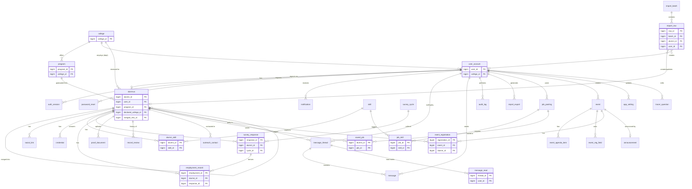
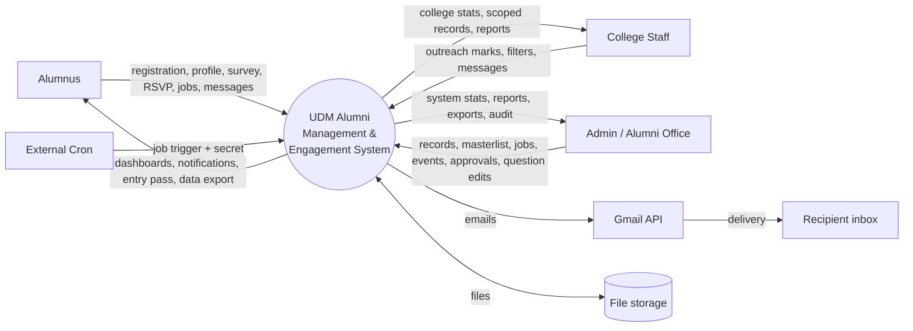
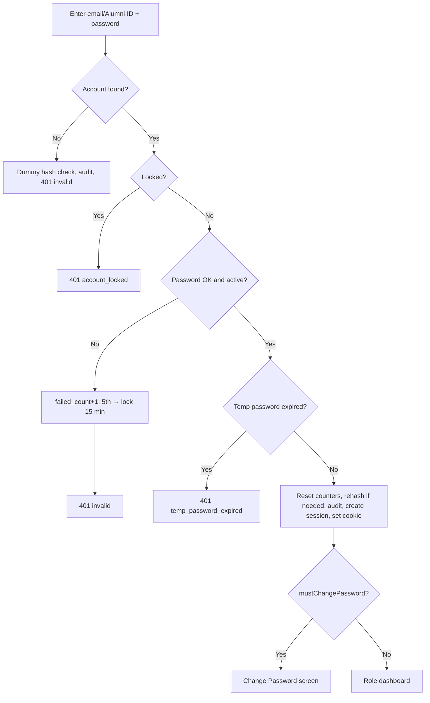
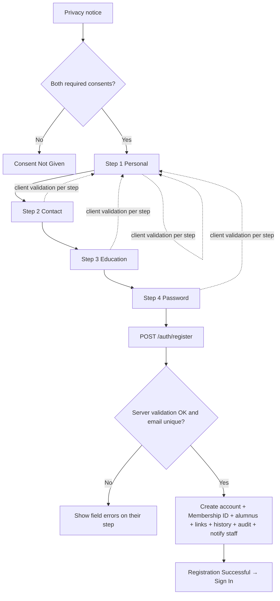
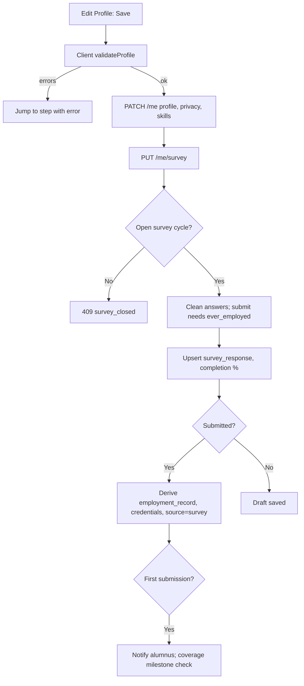
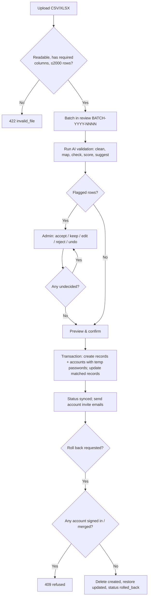
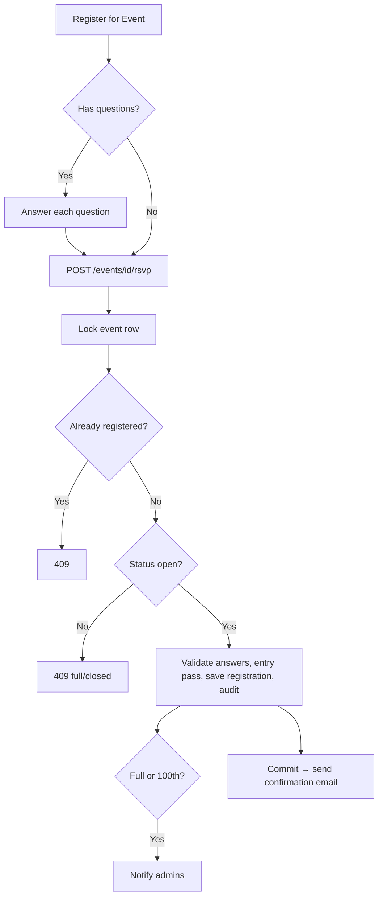
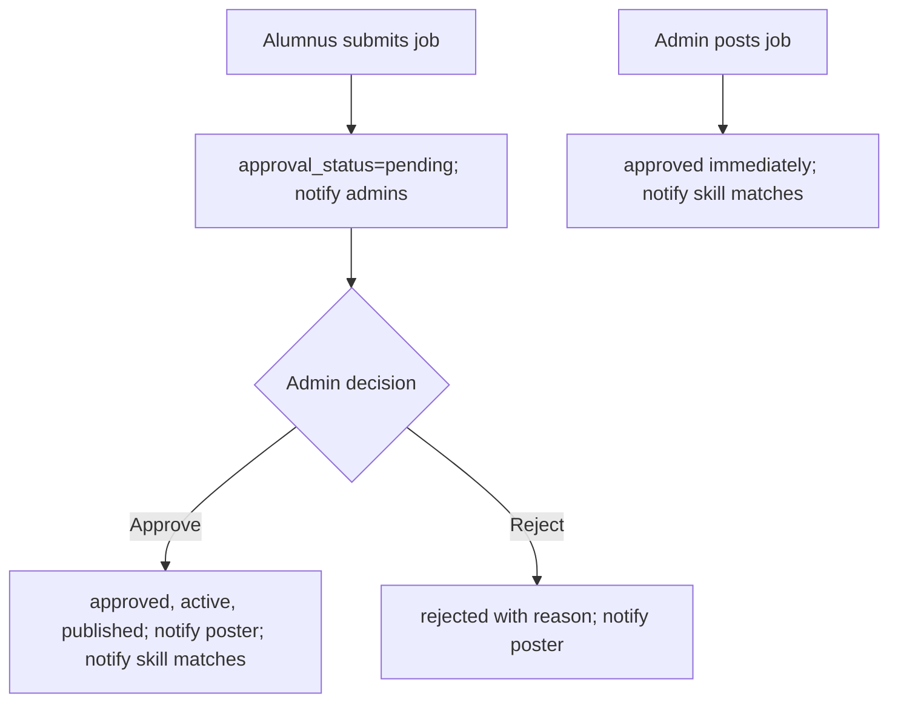
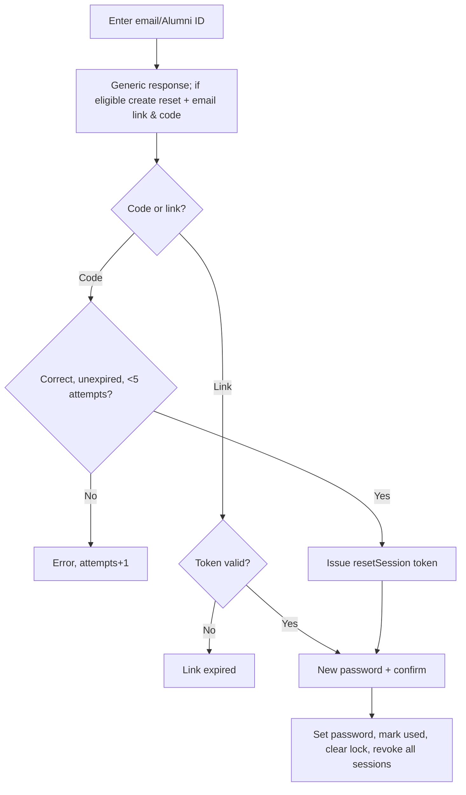
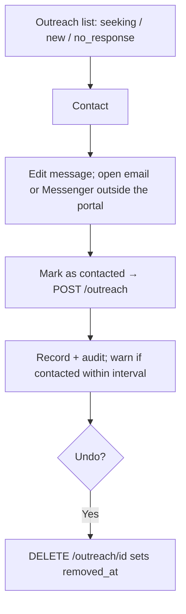

# UDM-AMES System Data — UDM Alumni Management & Engagement System

**Source of truth:** this document was produced by reading the `udm-alumni-ver2` repository (backend `backend/`, frontend `client/`, shared email templates `emails/`, deployment files `Dockerfile`, `backend/docker/start.sh`, `vercel.json`, load test `loadtest/`). Every statement is traceable to a file in the repository; file paths are given so each fact can be checked. Where the code exposes a capability that has no screen (or a screen that only shows text), this is stated explicitly instead of being filled in.

In code the product is named **"UDM Alumni Tracer"** (`APP_NAME="UDM Alumni Tracer"` in `backend/.env.example`; composer package `udm/alumni-tracer-api`) and the portal is branded **"UDM Alumni"** on screens.

---

## 0. How this document maps to capstone chapters

| Capstone chapter / artifact | Sections in this document |
|---|---|
| Ch. 1 Introduction — purpose, scope, users | §1, §6 |
| Ch. 2 Review / Technical background — technologies | §2, §15 |
| Ch. 3 Methodology — system architecture, requirements | §3, §4, §7 |
| Ch. 3 Design — ERD / data dictionary | §10 |
| Ch. 3 Design — Context diagram, DFD | §16.1–§16.3 |
| Ch. 3 Design — Use case diagram + descriptions | §6, §16.4 |
| Ch. 3 Design — Activity diagrams / flowcharts | §7, §16.5 |
| Ch. 3 Design — Wireframes / UI design | §8 |
| Ch. 4 Implementation — modules, API, security | §5, §7, §11, §12, §13, §14 |
| Ch. 4 Testing — test cases, validation rules | §9, §17 |
| Ch. 4 Deployment — hosting, network, environment | §3, §4 |
| Appendix — User manual | §8 (screen by screen) |

---

## 1. System Overview and Purpose

### 1.1 Purpose (from the code)
A web portal for Universidad de Manila (UDM) that:
1. **Registers graduates** (self-registration, staff encoding, CSV import, and a registrar masterlist import with a rule-based "AI" validator).
2. **Collects the alumni tracer survey** (employment, self-employment, time to first job, course relevance, feedback) per **survey cycle** (`survey_cycle`; seeded first cycle "AY 2025–2026", 2026-09-28 to 2026-11-15, `backend/database/seeders/data/catalog.php`).
3. **Computes graduate-outcome statistics** (coverage, employment rate, degree alignment, months to first job, first-generation, Indigenous Peoples and PWD inclusion) from database views so every screen agrees (`backend/database/sql/002_views.sql`, `StatsService`).
4. **Produces institutional reports** — five report types including "UDM Alumni Survey — Form A" (`ReportsService::TYPES`), exported as PDF/Excel/CSV in the browser and logged on the server.
5. **Engages alumni** — job board with approval queue, events with RSVP and entry passes, announcements, alumni directory, one-to-one messages, bell notifications.
6. **Supports outreach** — lists unresponsive / job-seeking / newly registered alumni for colleges and records offline contact attempts.
7. **Complies with RA 10173 (Data Privacy Act of 2012)** — consent before registration, directory opt-in (hidden by default), audit log of sensitive reads, personal data export (`GET /me/export`).

### 1.2 Scope boundaries visible in the code
- The portal **does not send** outreach, job-application, or follow-up messages itself. Staff and alumni use their own email app (`mailto:`) or Facebook Messenger (`m.me` links); the portal only **records** the attempt (`OfflineContactModal.jsx`, `OutreachController`, `JobService::apply`, `AlumniService::emailComposed`).
- The portal **does** send three transactional emails through the Gmail API: password reset, event registration confirmation, and account invite for imported alumni (§15).
- The "AI" in *AI Data Management* is a **rule-based validator on the server**; no data leaves the server and no external AI service is called (`ImportService` class comment).

---

## 2. Technology Stack (exact versions)

Versions are from `backend/composer.lock`, `client/package-lock.json`, `Dockerfile`, and manifests.

### 2.1 Backend
| Component | Version / constraint | Source |
|---|---|---|
| PHP (required) | `^8.3` | `backend/composer.json` |
| PHP (runtime image) | `php:8.4-cli-bookworm` | `Dockerfile` |
| PHP extensions installed | `pdo_pgsql`, `zip`, `intl`, `opcache`, `pcntl` | `Dockerfile` (`install-php-extensions`) |
| Laravel framework | constraint `^13.17`, locked **v13.37.0** | composer.json / composer.lock |
| laravel/tinker | v3.0.2 | composer.lock |
| league/flysystem-aws-s3-v3 | 3.35.3 (pulls aws/aws-sdk-php 3.401.2) | composer.lock |
| Composer | 2 (`composer:2` image) | Dockerfile |
| Password hashing | argon2id (memory 65536 KiB, time 4, threads 1) | `backend/config/hashing.php` |
| Dev/test: Pest | v5.3.3 (+ pest-plugin-laravel ^5.0) | composer.lock |
| Dev/test: PHPUnit | 13.4.3 | composer.lock |
| Dev: Larastan (PHPStan) | v3.13.0 | composer.lock |
| Dev: Laravel Pint | v1.32.1 | composer.lock |
| Dev: others | fakerphp/faker ^1.23, mockery ^1.6, nunomaduro/collision ^8.6, laravel/pail ^1.2.5, laravel/pao ^1.0.6 | composer.json |

No Sanctum, Breeze, Fortify, PhpSpreadsheet, or Google API client library is used: auth, Excel reading/writing, and the Gmail call are implemented in project code (`config/auth.php` comment; `App\Support\Masterlist`; `RecordExportService::xlsx`; `App\Mail\GmailTransport`).

### 2.2 Database
| Component | Detail | Source |
|---|---|---|
| DBMS | PostgreSQL ("Local Postgres 16 on 5433") | `backend/.env.example` |
| Driver | `pgsql` (pdo_pgsql) | `config/database.php` |
| Connections | `pgsql` (`DB_URL`, pooled) and `pgsql_direct` (`DB_URL_DIRECT`, used for migrations) | `config/database.php`, `docker/start.sh` |
| Schema style | raw SQL files run by Laravel migrations; Postgres enums, `jsonb`, `timestamptz`, identity keys, views, triggers | `backend/database/sql/*.sql` |

### 2.3 Frontend
| Component | Version (locked) | Source |
|---|---|---|
| React / React DOM | 18.3.1 | package-lock.json |
| React Router DOM | 6.30.6 (constraint ^6.28.0) | package-lock.json |
| Vite | 5.4.21 (constraint ^5.4.11) | package-lock.json |
| @vitejs/plugin-react | ^4.3.4 | package.json |
| Node.js (build image) | `node:22-alpine` | Dockerfile |
| Test: Vitest | 2.1.9 (+ @vitest/coverage-v8 ^2.1.9) | package-lock.json |
| Test: Testing Library | @testing-library/react ^16.3.3, dom ^10.4.2, jest-dom ^7.0.1, user-event ^14.6.8 | package.json |
| Test: jsdom / vitest-axe | ^30.1.2 / ^0.1.0 | package.json |
| Lint/format | ESLint 9.39.5 (+ react, react-hooks, jsx-a11y plugins), Prettier ^3.3.3 | package.json |
| Bundle analysis | rollup-plugin-visualizer ^7.1.1 | package.json |

No UI component library, chart library, or state library is used; charts and UI are hand-written React with inline styles; global state is React Context (`client/src/context/*`). Fonts: Google Fonts allowed by the CSP (`fonts.googleapis.com`, `fonts.gstatic.com`).

### 2.4 Tooling
- **k6** load test script `loadtest/k6-alumni.js` (README: smoke 30 s, `PROFILE=load` ~100 users for 5 min; never against production).

---

## 3. System Architecture, Hosting, Deployment and Network Setup

### 3.1 Architecture
- **Three-tier web application**: React single-page application (presentation) → Laravel REST API under `/api/v1` (application/business logic in Services) → PostgreSQL (data, including statistical views).
- **Single-host deployment**: one Docker image serves both the API and the built React app from the same origin (`Dockerfile` comment "Single-host image"). `SpaController` returns `index.html` for every non-API path so client routes survive reloads; `/api/*` unknown paths return JSON 404 (`backend/app/Http/Controllers/SpaController.php`, `bootstrap/app.php` `Route::fallback`).
- **Same-origin cookie session**: the client calls `/api/v1` relative to its own origin (`client/src/lib/api.js`, `API_BASE = VITE_API_URL || '/api/v1'`), so no CORS configuration exists.
- **Layered backend**: Routes (`routes/api.php`) → Middleware → Controllers (`app/Http/Controllers/Api/V1`) → Services (`app/Services`) → Support helpers (`app/Support`) → DB (query builder / raw SQL; two Eloquent models `UserAccount`, `Alumnus`).

### 3.2 Build and container (Dockerfile, 3 stages)
1. **client** (`node:22-alpine`): `npm ci`, copy `client/` and `emails/`, `npm run build` → `client/dist`.
2. **vendor** (`composer:2`): `composer install --no-dev`.
3. **runtime** (`php:8.4-cli-bookworm`): installs PHP extensions; copies backend + vendor; copies built client into `public/`, moves `index.html` to `resources/spa/index.html`; copies `emails/` to `resources/emails/`.
   - Environment baked in: `APP_ENV=production`, `APP_DEBUG=false`, `LOG_CHANNEL=stderr`, `SPA_INDEX_PATH`, `EMAIL_TEMPLATES_PATH`, `SESSION_SECURE_COOKIE=true`, `PHP_CLI_SERVER_WORKERS=4`, `PORT=8080`.
   - `EXPOSE 8080`, `CMD ["docker/start.sh"]`.

### 3.3 Container start sequence (`backend/docker/start.sh`, `set -e`)
1. `php artisan config:cache`
2. `php artisan migrate --force --database=pgsql_direct`
3. `php artisan db:seed --class=LookupSeeder --force` (colleges, programs, skills, default settings, first survey cycle — idempotent)
4. `php artisan app:ensure-admin` (creates the built-in admin if missing)
5. `exec php artisan serve --host=0.0.0.0 --port=${PORT:-8080} --no-reload`

If any step fails the script exits (`set -e`) and the container stops.

### 3.4 Hosting references in code
- **Railway**: `bootstrap/app.php` comment "Railway's edge proxy terminates TLS" (hence `trustProxies(at: '*')`); Dockerfile comment "Railway (or any Docker host) builds this from the repo root".
- **Neon PostgreSQL**: the production check rejects a `DB_URL_DIRECT` containing `-pooler` (Neon's pooler host naming) and requires a separate direct URL (`AppServiceProvider::productionConfigProblems`); `.env.example` mentions "a Neon dev branch via DB_URL".
- **Vercel (client only, alternative)**: `vercel.json` (root) installs and builds `client/` and rewrites every path to `/index.html`; `client/vercel.json` has the same rewrite. These files contain no API proxy rule.
- **File storage**: `FILESYSTEM_DISK=local` (needs a persistent volume at `storage/app`) or `s3` (any S3-compatible bucket; `AWS_ENDPOINT`, `AWS_USE_PATH_STYLE_ENDPOINT`) (`StorageService`, `.env.example`).

### 3.5 Network setup
| Item | Value | Source |
|---|---|---|
| Container listen port | 8080 (`PORT`) | Dockerfile, start.sh |
| TLS | terminated by the host's edge proxy; app trusts all proxies for client IP and scheme | `bootstrap/app.php` |
| HSTS | `Strict-Transport-Security: max-age=31536000; includeSubDomains` in production | `SecurityHeaders` |
| Local API | `php artisan serve --port=4000` (`composer dev`) | composer.json |
| Local client | Vite dev server (default port 5173; `APP_URL=http://localhost:5173` in `.env.example`) proxying `/api` → `http://localhost:4000` (or `VITE_API_PROXY`) | `client/vite.config.js` |
| Local DB | 127.0.0.1:5433, database `udm_alumni`, user `postgres` | `.env.example`, `config/database.php` |
| DB SSL | `DB_SSLMODE` default `prefer`; `.env.example` notes production URLs use `sslmode=require` | config/database.php |
| Outbound HTTPS | `https://oauth2.googleapis.com/token`, `https://gmail.googleapis.com/gmail/v1/users/me/messages/send` | `GmailTransport` |
| Inbound machine call | `POST /api/v1/internal/jobs/{name}` with header `X-Cron-Secret` (external cron) | `InternalJobsController` |
| Health check | `GET /api/v1/health` (runs `select 1`; 200 `{ok:true,db:'up'}` or 503) | `HealthController` |

### 3.6 Deployment diagram (text)
```
[Browser: React SPA] --HTTPS--> [Host edge proxy / TLS] --HTTP:8080--> [Docker container]
                                                                        ├─ php artisan serve (4 workers)
                                                                        │   ├─ /api/v1/*  → Laravel API
                                                                        │   └─ /*         → SpaController → index.html (+ static assets in public/)
                                                                        ├─ storage/app (local disk / volume)  or  S3-compatible bucket
                                                                        └─ outbound HTTPS → Google OAuth2 + Gmail API
[PostgreSQL] <── pooled URL (app) / direct URL (migrations) ──┘
[External cron] --POST /api/v1/internal/jobs/{name} + X-Cron-Secret--> container
```

---

## 4. Environment Requirements and Configuration

### 4.1 Runtime requirements
- PHP 8.3+ (8.4 in the image) with: `pdo_pgsql`, `zip` (xlsx read/write via `ZipArchive`), `intl`, `opcache`, `pcntl`; also used by code: `fileinfo` (MIME detection from file bytes), `openssl` (service-account JWT signing), `SimpleXML`/`libxml` (xlsx parsing), `mbstring`, and an argon2id-capable build (`PASSWORD_ARGON2ID` is checked at boot in production).
- PostgreSQL 16 (local), any PostgreSQL with `jsonb`, enums, `pg_advisory_xact_lock`, `FILTER`, `LATERAL`.
- Node.js 22 to build the client; npm.
- A Gmail/Google OAuth client (or Workspace service account) for production email.

### 4.2 Environment variables (from `backend/.env.example` and config)
| Variable | Purpose / default |
|---|---|
| `APP_NAME` | "UDM Alumni Tracer" |
| `APP_ENV` | `local` / `testing` / `staging` / `production` |
| `APP_KEY` | required in production (signs private file URLs) |
| `APP_DEBUG` | must be `false` in production |
| `APP_URL` | public frontend URL used in email links; must be `https://` and not localhost in production |
| `APP_TIMEZONE` | `UTC` (application clock; Manila dates computed explicitly) |
| `DB_CONNECTION`, `DB_HOST`, `DB_PORT` (5433), `DB_DATABASE` (udm_alumni), `DB_USERNAME`, `DB_PASSWORD`, `DB_SSLMODE` | database |
| `DB_URL` / `DB_URL_DIRECT` | pooled URL for the app / direct URL for migrations (both required in production, must differ, direct must not contain `-pooler`) |
| `HASH_DRIVER` | `argon2id` (production refuses others); `ARGON_MEMORY`, `ARGON_THREADS`, `ARGON_TIME`, `HASH_VERIFY` |
| `ADMIN_EMAIL` / `ADMIN_PASSWORD` | built-in admin (default `admin@udmalumni.edu`); password used only when creating it |
| `SESSION_TTL_DAYS` (14), `SESSION_IDLE_HOURS` (12), `SESSION_SECURE_COOKIE` | session cookie lifetime, idle timeout, Secure flag |
| `AUTH_RATE_LIMIT` | requests/min/IP on throttled `/auth/*` routes (default 10) |
| `CACHE_STORE=file`, `SESSION_DRIVER=array`, `QUEUE_CONNECTION=sync` | no Laravel session or queue is used |
| `MAIL_MAILER` | `log` / `gmail` / `smtp` (`log` and `array` refused in production) |
| `MAIL_FROM_ADDRESS` / `MAIL_FROM_NAME` | `udm.alumni.mailer@gmail.com` / "UDM Alumni Relations" |
| `EMAIL_TEMPLATES_PATH` | template folder (default `../emails`) |
| `GOOGLE_OAUTH_CLIENT_ID`, `GOOGLE_OAUTH_CLIENT_SECRET`, `GOOGLE_OAUTH_REFRESH_TOKEN` | Gmail OAuth mode |
| `GOOGLE_SERVICE_ACCOUNT_JSON`, `GOOGLE_IMPERSONATE_USER` | Gmail service-account mode (alternative) |
| `FILESYSTEM_DISK` | `local` or `s3`; `AWS_ENDPOINT`, `AWS_DEFAULT_REGION`, `AWS_BUCKET`, `AWS_ACCESS_KEY_ID`, `AWS_SECRET_ACCESS_KEY`, `AWS_USE_PATH_STYLE_ENDPOINT` |
| `CRON_SECRET` | protects `/internal/jobs/*`; ≥ 24 characters in production |
| `ALLOW_DEMO_SEED`, `DEMO_ALUMNI` | demo seeder controls (non-production only) |
| `SPA_INDEX_PATH` | path of the built `index.html` |
| Client: `VITE_API_URL`, `VITE_API_PROXY`, `VITE_DEMO` | API base, dev proxy target, demo UI switch |

### 4.3 Production configuration check (fail-fast at boot)
`AppServiceProvider::checkEnvironment()` throws at boot when `APP_ENV=production` and any of these is wrong: `APP_DEBUG` true; missing `APP_KEY`; `APP_URL` not https / localhost; missing `DB_URL`; `DB_URL_DIRECT` missing, equal to `DB_URL`, or a `-pooler` host; `MAIL_MAILER` = `log`/`array`; Gmail mailer without valid credentials; `FILESYSTEM_DISK=s3` without bucket/key/secret/region; session cookie not Secure; hash driver not argon2id or PHP lacks argon2id; `CRON_SECRET` shorter than 24 characters.

### 4.4 Local setup commands (from manifests)
- Backend: `composer setup` (install, copy `.env`, `key:generate`, `migrate --seed`), `composer dev` (serve on 4000), `composer test` (Pest), `composer lint` (Pint + PHPStan).
- Client: `npm run dev`, `npm run build`, `npm test` (Vitest), `npm run lint`, `npm run build:analyze`.
- Root `package.json`: `install:client`, `dev`, `build`, `preview` proxy to `client/`.

---

## 5. Folder Structure

```
udm-alumni-ver2/
├─ Dockerfile                 single-host image (client build + PHP runtime)
├─ vercel.json                client-only build/rewrite config
├─ package.json               root scripts delegating to client/
├─ emails/                    shared email templates (HTML + TXT) and senders.json
│   ├─ account-invite.html/.txt
│   ├─ event-registration.html/.txt
│   ├─ password-reset.html/.txt
│   └─ senders.json
├─ loadtest/                  k6 load test (k6-alumni.js, README.md)
├─ docs/                      project documents
├─ backend/                   Laravel 13 REST API
│   ├─ app/
│   │   ├─ Auth/SessionGuard.php            custom cookie-session guard
│   │   ├─ Console/Commands/                artisan commands (create-user, ensure-admin, jobs, mail-test, google-oauth-token)
│   │   ├─ Exceptions/ApiException.php      error shape {error, code, fields}
│   │   ├─ Http/Controllers/Api/V1/         20 API controllers
│   │   ├─ Http/Controllers/SpaController.php
│   │   ├─ Http/Middleware/                 RequestId, RequirePasswordChange, RequireRole, RequireXhr, SecurityHeaders
│   │   ├─ Http/Requests/Auth/              Login, Register, ForgotPassword, NewPassword form requests
│   │   ├─ Mail/                            GmailTransport, EmailTemplate, 3 Mailables
│   │   ├─ Models/                          UserAccount, Alumnus
│   │   ├─ Providers/AppServiceProvider.php guard, mailer, rate limiters, production check
│   │   ├─ Services/                        21 business services
│   │   └─ Support/                         Scope, RegistrationRules, SurveyMapping, ProfileProgress, Masterlist, Vocab, Mobile, Contact, EntryPass, Lists
│   ├─ bootstrap/app.php                    routing, middleware, error rendering
│   ├─ config/                              app, auth, database, filesystems, hashing, mail, services, …
│   ├─ database/
│   │   ├─ migrations/                      5 migrations (each loads a SQL file or runs SQL)
│   │   ├─ sql/001_schema.sql … 004_imports.sql
│   │   └─ seeders/                         DatabaseSeeder, LookupSeeder, DemoSeeder, data/catalog.php
│   ├─ docker/start.sh                      container start script
│   ├─ routes/api.php, routes/console.php
│   └─ tests/Feature (19 files), tests/Unit (4 files)
└─ client/                    React 18 + Vite SPA
    ├─ index.html, vite.config.js, eslint.config.js, vercel.json
    ├─ public/                logos (alumni-logo.png, udm-logo.jpg)
    └─ src/
        ├─ main.jsx, App.jsx  bootstrap (loads /lookups and /tracer/questions first)
        ├─ routes/            AppRoutes.jsx, guards.jsx
        ├─ layouts/           AppShell, PortalPage
        ├─ context/           Auth, Profile, Jobs, Events, Search, Toast, ResetFlow
        ├─ pages/             auth/, alumni/, admin/, college/ (route-level containers)
        ├─ views/             presentational screens (*View.jsx)
        ├─ components/        NavSidebar, Topbar (+ NotificationBell, SearchPill, UserChip), MessagesWidget, Modal, FormField, DatePicker, OfflineContactModal, Pager, …
        ├─ hooks/             useRecordsPage, useReportsPage, useAvatarPicker, …
        ├─ lib/               api.js, validation.js, analytics.js (report export), adminDash.js, collegeDash.js, contact.js, questionStore.js, …
        ├─ data/              formDefs.js (form questions), navigation.js, colleges.js, events.js, jobs.js, …
        ├─ styles/            global.css, prototype.css
        └─ test/              test setup and mock API
```

---

## 6. User Roles and Permissions

### 6.1 Roles (enum `user_role`)
| Role (DB value) | Display (`AccountService::payload`) | Scope (`App\Support\Scope`) | How accounts are created |
|---|---|---|---|
| `alumni` | "Alumni" | own alumnus record only | self-registration (`POST /auth/register`), or masterlist import confirm (temporary password) |
| `dept` (College / Department staff) | `role_label` or "College Staff" (client label "College Dean") | only alumni whose program's college (or declared college) equals the account's `college_id`; `college_id` is mandatory (`dept_has_college` constraint) | `php artisan app:create-user --role=dept --college=CODE` or `POST /users` |
| `admin` (Alumni Relations Office) | `role_label` or "Administrator" | everything | `app:ensure-admin` (built-in), `app:create-user --role=admin`, or `POST /users` |
| (unauthenticated visitor) | — | public endpoints only | — |
| (system / cron) | — | `POST /internal/jobs/*` via `X-Cron-Secret` | — |

Scope is computed on the server from the signed-in user; the client never sends a scope (`Scope` class comment).

### 6.2 Permission matrix (API, from `routes/api.php` middleware + service checks)
Legend: ✔ allowed · S scoped (dept: own college; alumni: own record) · — denied (401/403)

| Capability | Visitor | Alumni | Dept | Admin |
|---|---|---|---|---|
| Health, lookups, tracer question config (read) | ✔ | ✔ | ✔ | ✔ |
| Register, sign in, forgot/reset password | ✔ | ✔ | ✔ | ✔ |
| Change password, sign out, session | — | ✔ | ✔ | ✔ |
| Own profile, survey, photo, proofs, data export (`/me/*`) | — | ✔ | — | — |
| Alumni directory (opt-in only) | — | ✔ | ✔ | ✔ |
| Alumni Records list/detail/create/edit/status/merge/map/import/proof request | — | — | S | ✔ |
| Statistics (`/stats/*`) and Reports (`/reports/*`) | — | — | S | ✔ |
| Outreach records | — | — | S | ✔ |
| Notifications (own) | — | ✔ | ✔ | ✔ |
| Messages | — | office + own-college threads | own-college alumni threads + own admin thread | office + admin threads |
| Job board read, job stats | — | ✔ | ✔ | ✔ |
| Create/edit/delete job posting, job photo | — | ✔ (own, while pending; goes to approval) | — | ✔ (published at once) |
| Save / apply to job | — | ✔ | — | — |
| Approve / reject / activate / deactivate / restore job; view queue | — | — | — | ✔ |
| Events read | — | ✔ (published only) | ✔ (published only) | ✔ (incl. drafts) |
| Create/edit/delete/duplicate/cancel event, cover photo, registrations list | — | — | — | ✔ |
| RSVP / cancel RSVP | — | ✔ | — | — |
| Announcements read | — | ✔ (visible) | ✔ (visible) | ✔ (incl. hidden) |
| Announcements write | — | — | — | ✔ |
| Tracer question edits, staff users, settings, audit log | — | — | — | ✔ |
| AI Data Management (imports, export, log) | — | — | — | ✔ |

Additional rule: any account with `must_change_password = true` receives **403 `password_change_required`** on every API route except `auth.*` routes, `/health`, `/lookups`, and public files (`RequirePasswordChange`).

### 6.3 UI-level restrictions (client)
- Route guards: `/alumni/*` requires role `alumni`, `/college/*` requires `dept`, `/admin/*` requires `admin`; others are redirected to their own dashboard; signed-out users to `/signin`; accounts on a one-time password to `/change-password` (`client/src/routes/guards.jsx`).
- **Alumni Records for `dept` is view-only in the UI** (`recCanEdit: !dept`, no selection/bulk actions, text "View-only · Contact the Alumni Relations Office to request changes to this record."), although the API itself allows scoped writes.

---

## 7. Modules and Features (with step-by-step workflows)

Module list (navigation from `client/src/data/navigation.js`):
- **Alumni:** Dashboard, Profile (+ Edit Profile with the tracer survey), Jobs, Events, Privacy & My Data; Messages widget; notification bell; alumni search.
- **College (dept):** Dashboard, Alumni Records (view-only), Outreach, Reports; Messages; bell; search.
- **Admin:** Admin Dashboard, Alumni Records, AI Data Management, Reports, Jobs, Events (incl. announcements), Alumni Tracer (question manager); Messages; bell; search.

### 7.1 Authentication & Account module
**Sign in** (`AuthController::login`)
1. User enters *Email or Alumni ID* and *Password* (Alumni ID matches `student_no` or `membership_id`, case-insensitive; staff sign in by email only).
2. Unknown account → a dummy hash check (equal timing), audit `login_failed (unknown_account)`, 401 "Incorrect email / Alumni ID or password."
3. Account locked (`locked_until` in future) → 401 `account_locked`.
4. Wrong password or `disabled` account → failed count +1; the 5th failure locks the account 15 minutes and resets the count; audit `login_failed`.
5. Temporary (import) password older than 7 days → 401 `temp_password_expired`.
6. Success (transaction): reset failure count, set `last_login_at`, rehash password if algorithm/params changed, audit `login`, create `auth_session` row, set `udm_sid` cookie.
7. Client routes to `/change-password` if `mustChangePassword`, else the role home.

**Self-registration** (`RegistrationService::register`)
1. `/register/consent`: user must tick two required consents (process data, accuracy); optional "comms" consent. "I Agree — Continue" stores consent in `sessionStorage` (`udm.privacy.consented`); "I Do Not Agree" clears it and shows "Consent Not Given".
2. `/register/details`: 4 steps — Personal Information → Contact & Social Media → Educational Background → Account Password; each step validated client-side before moving forward.
3. Submit → `POST /auth/register` with all fields + `privacy_consent: true` (+ `marketing_opt_in`, which the backend does not store).
4. Server re-validates every field (`RegistrationRules`, same messages, Admin's tracer edits applied); rejects duplicate email (409 `email_taken`).
5. Resolves college + program to a catalog `program_id`, or stores a typed program (`course_other` + `declared_college_id`) when college "Others" is chosen.
6. Transaction: insert `user_account` (role alumni, active, argon2id hash) → generate Membership ID `AM-YYYY-NNNNN` (advisory lock, sequence per graduation year) → insert `alumnus` (verified, source `self_registration`, `privacy_consent_at`) → `social_link` rows (hidden) → `record_review` (create) → `audit_log` (register) → notifications to all active admins and the college's dept users.
7. 201 → `/register/success` shows a summary; user signs in next (no auto sign-in).

**Forgot / reset password** (`PasswordResetService`)
1. Step 1: enter email or Alumni ID → `POST /auth/forgot-password`; always the same 200 message (no account enumeration). Max 3 reset emails per account per 15 minutes (extra silently skipped).
2. Server creates a `password_reset` row with SHA-256 token hash + code hash bound to the token, 30-minute expiry, previous open resets expired; emails link `APP_URL/reset-password?token=…` and a 6-digit code.
3. Step 2 (code path): enter code → `POST /auth/reset-password/verify-code`; max 5 wrong attempts per reset; success issues a new single-use `resetSession` token (the emailed link stops working).
   Link path: `/reset-password?token=` → `GET /auth/reset-password/verify` → valid opens step 3, invalid shows "Link expired" (step 5).
4. Step 3: new password + confirm (rules: ≥ 8 chars, 1 number, 1 uppercase, match) → `POST /auth/reset-password`.
5. Server marks reset used, sets hash, clears `must_change_password`, temp expiry, failures and lock; revokes all sessions; audit. Step 4 "Password updated".

**Change password** (`/change-password`, `POST /auth/change-password`): required for one-time/temporary passwords; checks current password, applies rules, clears `must_change_password`, signs out all other sessions.

**Sign out**: `POST /auth/logout` revokes the session row and clears the cookie.

### 7.2 Alumni Profile & Tracer Survey module
- **View profile** (`/alumni/profile`): sections Personal Details, Contact & Social Media Details, Educational Background, Employment & Career, Alumni Feedback; "Edit Profile"; "View Alumni ID" (modal ID card with Alumni ID No. and verified mark); social links open in a new tab.
- **Edit Profile flow** (`/alumni/profile/edit`) — 5 steps: (1) Personal Information (+ photo), (2) Contact & Social Media, (3) Educational Background (+ survey section III: first-gen, UDMCAT, honors, professional exams), (4) Employment & Career (survey sections IV–VI), (5) Alumni Feedback (section VII).
  1. User edits fields; conditional questions appear by rule (e.g. married name if Married; Employment Details if ever employed = Yes; Self-Employment if self-employed; unemployed reasons if ever employed = No; stay reasons if still working = Yes).
  2. Save / Save & Continue / Finish → client `validateProfile` → `PATCH /me` (profile fields, `privacy`, `skills`) and `PUT /me/survey` (answers, current section) → photo upload/removal (`POST/DELETE /me/photo`).
  3. Server `ProfileService::apply`: re-validates with registration rules (without password/consent), checks email uniqueness and updates the sign-in email, resolves program, updates alumnus (`record_source = alumni_update`), display name, social links; `record_review` with diff (sensitive fields logged as "changed" only); audit `profile_update`; recompute `completion_pct`.
  4. Server `SurveyService::save`: requires an **open** survey cycle (409 `survey_closed`); cleans answers against allowed options; on submit requires `ever_employed`; upserts `survey_response` (draft or submitted; once submitted stays submitted); on submit derives the current `employment_record`, replaces honor/exam `credential` rows, sets `record_source = survey`; first submit notifies the alumnus and may trigger a coverage-milestone notification to admins/college.
  5. Unsaved-changes guard: browser `beforeunload` and a "Discard your changes?" modal.
- **Completion %** (`ProfileProgress::compute`): answered ÷ required visible questions across profile + survey, honoring Admin edits (hidden questions excluded; added questions count only when required).
- **Employment derivation** (`SurveyMapping::employment`): ever employed = No → `further_studies` if reasons include "Advance or further study", else `not_employed`; Yes → `not_employed` if not still working; `self_employed` if job status Self-employed or org type Self-owned business; else `employed`. Time-to-job bucket midpoint stored in `months_to_first_job` (0.5, 3.5, 9, 18, 30, 42, 54).

### 7.3 Privacy & My Data module (`/alumni/privacy`)
- "What we hold about you": expandable cards (Personal, Contact, Education, Employment, Survey feedback, Photo/skills, Account activity) with View/Edit (Edit opens the matching Edit Profile step).
- Directory visibility toggles save immediately (`PATCH /me` `privacy`): Show me in the alumni directory, Show Email address, Show Mobile number, per-platform link visibility; all start hidden (DB defaults false).
- Rights: Read the Privacy Notice (modal), **Download My Data** (`GET /me/export`, JSON attachment, audited, 10/min), Edit Profile, "Email the office" (mailto withdraw consent), "Request deletion" (mailto `udmalumni@udm.edu.ph`), link to National Privacy Commission (privacy.gov.ph).

### 7.4 Alumni Directory & Search
- Topbar "Search for an Alumni" (Ctrl K) opens a search overlay. Alumni search `GET /directory` (only `directory_opt_in` alumni, not archived/merged); staff search `GET /alumni?status=verified`.
- Result card (AlumniCardView): career journey, degree relevance, skills (top 3 + more), "Contact Alumni" → contact modal showing only shared methods (email/mobile only if `show_email`/`show_mobile`; visible social links) as `mailto:`, `tel:`, `m.me` links.

### 7.5 Job Board module
**Alumni** (`/alumni/jobs`)
1. Board lists approved + active postings (`GET /jobs`, refreshed every 60 s); tiles Open Positions, Alumni Employers, Salary Benchmark, Placement Response (`GET /jobs/stats`).
2. Filter chips All / Full-time / Remote / Internship / Contract; selects Modality, Location, Sort; search box; "Saved Jobs" toggle; Reset filters; 5 per page.
3. Save/unsave (`POST/DELETE /jobs/{id}/save`).
4. Apply → "Apply for {title}" modal with editable prefilled message and the channels the posting has (Email → mailto, Careers page → opens URL and copies message, Facebook Messenger → opens m.me and copies message) → "Mark as applied" → `POST /jobs/{id}/apply {via}` (server checks the posting supports that channel). Applying again withdraws (`DELETE /jobs/{id}/apply`).
5. Post a Job → composer (fields in §8) → `POST /jobs` (+ photo) → status `pending`, admins notified "Job posting submitted for review".
**Admin** (`/admin/jobs`)
1. Post/edit job (published immediately, `source=admin`); alumni whose skills match the job tags get a "New job match" notification.
2. Approval queue: open submission → Approve (publishes; poster notified; skill matches notified) or Reject (poster notified with reason if given).
3. Listing actions: Edit, Deactivate/Activate, Delete (soft delete, confirm dialog); "Preview" modal of what alumni see. API also supports `restore`.

### 7.6 Events & Announcements module
**Alumni** (`/alumni/events`)
1. List (filters All / Events / Career / Community), upcoming then past; detail panel with date, time, venue, fee, about, highlights, program (agenda), registration count, capacity bar.
2. Register for Event → if the event has registration questions a dialog requires one option per question → `POST /events/{id}/rsvp`.
3. Server (transaction, row lock): rejects duplicates and non-open status (full/closed/past/cancelled); validates answers; computes entry pass `UDM-XXXX-NNNNN`; upserts `event_registration`; audit; capacity-full and every-100 milestone notifications to admins; after commit emails confirmation (Gmail).
4. Cancel registration (`POST /events/{id}/cancel`); "+ Add to Calendar" opens a prefilled Google Calendar page (client-only).
**Admin** (`/admin/events`)
1. Tabs Upcoming / Past / Cancelled; search; status filter; row menu: Edit, Duplicate, Close/Reopen registration, Move to past, Cancel event, Delete; manage drawer with Going / Cancelled / Spots left and registration list download (CSV).
2. Create/Edit event form → `POST/PATCH /events` → publishing notifies **all active alumni** "New event"; editing date/time/venue of a published event notifies registrants; cancel notifies registrants.
3. Announcements (standalone notices): New announcement (kind Notice/Reminder/Update, title, body) → `POST /announcements`; edit; remove. Event-linked announcements can be hidden from/shown on the dashboard (`annHidden`).

### 7.7 Alumni Records module (`/admin/records`, `/college/records`)
1. List with tabs All / Verified / Flagged / Archived, search (name, Membership ID, student no., email, employer, program), filters program/batch/employment, sort, pagination (`GET /alumni`), counters (`GET /stats/counters`), recent activity (`GET /alumni/activity`).
2. Review drawer (`GET /alumni/{id}`, audited as `read_sensitive`): details, data issue note, uploaded proof (signed links, `GET /alumni/{id}/proofs`), edit history.
3. Add / Edit record form → `POST /alumni` / `PATCH /alumni/{id}` (Membership ID assigned on save; source admin_encoded unless chosen; status change maps to verify/flag/archive actions).
4. Row actions: View edit history; Send email / follow-up (opens mail app, logs "Email composed"); Request document proof (docs checklist, due 7/14/30 days, note → `POST /alumni/{id}/request-proof`, sets flag note, creates pending `proof_document`, notifies alumnus); Reassign program/batch (reason required); Archive/Restore (reason required); Mark as duplicate/flag → Confirm as duplicate (merge into chosen record).
5. Bulk: Mark verified, Flag, Export CSV (client-side), Delete (= archive, with Undo).
6. Import alumni master list (CSV parsed in the browser: name, program, batch, employment, employer, student no., email) → `POST /alumni/import` (rows with existing student no. skipped; failing rows reported).
7. **Merge rules** (`AlumniService::merge`): cannot merge a record into itself or when both have sign-in accounts (409); moves login and missing identifiers; moves non-colliding child rows; marks source `merged_into_id`; two `record_review` rows; audit.

### 7.8 AI Data Management module (Admin, `/admin/ai-data`)
Tabs: **Import masterlist**, **Export records**, **Audit log**. Import steps: Upload → AI review → Preview & confirm → Synced.
1. **Upload** CSV or .xlsx (≤ 5 MB, ≤ 2,000 rows) → `POST /imports`; header row auto-detected (first of top 10 rows naming ≥ 2 template columns); required columns Full name (or Last+First), Program, Year graduated; batch code `BATCH-YYYY-NNNN`; TEMPLATE CHECK shows found columns. "Replace file" discards a batch in review.
2. **Run AI validation** (`POST /imports/{id}/validate`): rule-based checks per row — name casing/spacing fix and split (handles "LAST, First M." and surname particles/suffixes); student no. format `YY-NN-NNN` (suggests fix from 7 digits); repeated student no./email in file; year present and 1999–current (suggests the year from the student-number prefix); college/program mapping (exact on code/abbr/name ignoring punctuation, ambiguous program, program offered by another college, closest catalog match by similarity ≥ 80%/70%); email validity; PH mobile validity; existing record by student no. (last name must match) or by name (possible duplicate → merge or create new); new records require a personal email not already used by an account. Each row gets a **confidence** score and at most one flag with a suggestion.
3. **Decide flagged rows** (`POST /imports/{id}/rows/{rowId}`): Accept suggestion, Keep alternative, Edit manually (field + value validated), Reject row, Undo.
4. **Preview & confirm** (`POST /imports/{id}/confirm`): refused while any flagged row is undecided; all-or-nothing transaction: new rows → alumnus (`record_source=import`) + alumni `user_account` with a 12-character temporary password (must change, expires 7 days); matched rows → update only changed fields and store the `before` values; batch → `synced` with result counts; after commit an **account invite email** is sent per new account; email failures are counted, not fatal.
5. **Roll back** (`POST /imports/{id}/rollback`): only for synced batches, refused if any created account has signed in or changed its password, or a record was merged into one of the batch records; deletes created alumni + accounts and restores updated rows.
6. **Export records** (`GET /imports/export`): preview (total, 5 sample rows, college chips, latest 3 batches) and file download (CSV with BOM and formula-injection guard, or .xlsx) of verified or flagged, non-archived records in the import template columns + Membership ID; audited (`records_export`).
7. **Audit log** (`GET /imports/log`): import, discard, AI validate, IDs assigned, accounts created, temporary passwords issued, rollback, export entries.

### 7.9 Statistics & Dashboards
- **Admin Dashboard** (`/admin/dashboard`): filters college, program, batch from/to, status; KPIs; graduates traced by batch vs target; employment status mix (donut); months before first job; signals; inclusion profile; latest survey submissions table; "Export report" goes to Reports with the same scope (`GET /stats/summary`, `/by-program`, `/by-batch`, `/inclusion`).
- **College Dashboard** (`/college/dashboard`): course and batch range filters; employability rate vs target; outcomes by batch; top 10 job titles; traced by batch; status mix; "Compare with university average" (`GET /stats/benchmark`); department insights; "Alumni needing outreach" (`GET /stats/unresponsive?per_page=5`).
- **Metric definitions** (`StatsService::metrics`, views): coverage = traced ÷ total; traced = has a *submitted* response in the active cycle; employed = traced and status employed/self_employed; labour force = traced − further studies (setting `employment_rate_excludes_further_studies`, default true); employment rate = employed ÷ labour force; aligned rate = employed with related course ÷ employed; first-gen rate, IP rate, PWD rate = ÷ traced; IP/PWD employment rates over their own labour force; average months = mean of bucket midpoints. Population excludes archived and merged records. Active cycle = the open cycle, else the latest closed one.

### 7.10 Outreach module (`/college/outreach`, also on College Dashboard)
1. List from `v_unresponsive`: reasons **seeking** (traced, not employed), **new** (not traced, registered within `new_registration_days`, default 14), **no_response** (not traced); shows last contact.
2. Contact → modal "Contact {name}" with editable message; channels on file (Email → mailto with subject "UDM Alumni Tracer — we’d love to hear from you"; Facebook Messenger → m.me + message copied).
3. "Mark as contacted" → `POST /outreach {alumni_id, method, message}` (30/min/user); response includes `recentlyContactedAt` within `outreach_interval_days` (default 7) for a warning.
4. "Remove contacted mark" → `DELETE /outreach/{id}` (sets `removed_at`). API also has `PATCH /outreach/{id}` for outcome (sent/reached/no_response/bounced).

### 7.11 Reports module (`/admin/reports`, `/college/reports`)
1. Report library (`GET /reports/types`, with last run): **UDM Alumni Survey — Form A** (Annual), **Employability by Program** (Quarterly), **Batch Coverage Audit** (Monthly), **Employer & Industry Distribution** (On demand), **Inclusion Profile — IP & PWD** (Annual).
2. Scope: college (dept fixed to own), course/program, batch from/to (default last five batches); drill level college → program → batch.
3. Live preview (`GET /reports/{type}`): KPIs, chart bars, table, key findings; Include toggles KPIs / Chart / Table / Findings.
4. Export format PDF / Excel / CSV → built in the browser (`lib/analytics.js`: CSV with BOM; Excel as an HTML table `.xls`; PDF via a hidden iframe and the browser print dialog) → `POST /reports/exports` records type, format, filters, record count, scope label (audited).
5. Generated reports history (`GET /reports/exports`; dept sees exports by accounts of its college) with re-download.
All report data is aggregated (no names, IDs or contacts).

### 7.12 Alumni Tracer question manager (Admin, `/admin/tracer`)
- Sections: Personal Information, Contact & Social Media (Section II), Educational Background, Additional Education Details (Section III), Account Password (Registration only), Employment Information (IV), Employment Details (V, shown if ever employed = Yes), Self-Employment Information (VI, shown if self-employed), Alumni Feedback (VII).
- Per question: edit Question text, Placeholder/helper text, Answer options (one per line, ≥ 2), Required, Shown/Hidden, reorder; "Reset to default text"; added questions can be deleted; "+ Add question" (types: short text, long text, single choice, dropdown, multi-select); "Reset all to default".
- Core fields cannot be hidden or optional: last_name, first_name, email, college, course, year_graduated, reg_pw, reg_pw2 (DB CHECK + service). Options of college/course/year and of stat-feeding questions (ever_employed, unemployed_reason, job_status, org_type, place_of_work, time_to_job, job_related, still_working, se_related, first_grad, udmcat) cannot be edited.
- Every write recomputes all active-cycle completion percentages.

### 7.13 Messages module (floating widget in the sidebar)
- Channels: **office** (alumnus ↔ Alumni Relations Office, any admin answers), **college** (alumnus ↔ their college's dept staff), **admin** (dept staff account ↔ office). Alumni never message each other.
- Alumni open/continue the office or college thread; dept staff can open their admin thread and reply to college threads; admins reply to office/admin threads. Staff see only threads that have messages.
- Polling: thread list every 20 s (5 s while open); opening a thread marks it read (`message_read.last_read_id`); messages 1–2,000 characters, 30 per minute per account.

### 7.14 Notifications (bell)
`GET /notifications` polled every 45 s while the tab is visible; Mark all as read; click marks one read. Types and triggers in §13.1. Read notifications older than `notification_retention_days` (default 90) are deleted daily.

### 7.15 Staff accounts, settings, audit (API only)
`GET/POST/PATCH /users`, `GET/PUT /settings`, `GET /audit` exist for admins; **no client screen calls them** (grep of `client/src`). Staff accounts are otherwise created with `php artisan app:create-user`.

---

## 8. Screens / Pages Catalog (for wireframes, test cases, user manual)

Global layout for signed-in pages: left **NavSidebar** (logo "UDM Alumni", role navigation, "More" on narrow screens, **Sign Out**, Messages widget) and **Topbar** (page title + caption, Search pill "Search for an Alumni · Ctrl K", Notification bell, user chip). Toasts appear for results; some actions offer **Undo**.

### 8.1 Public / authentication screens
| Screen (route) | Elements | Inputs & validation | Actions / results |
|---|---|---|---|
| **Sign In** (`/signin`) | brand panel ("Welcome Back, Alumni!", Connect · Grow · Give Back); demo access panel only when `SHOW_DEMO` (dev or `VITE_DEMO=true`) | *Email or Alumni ID* (placeholder "name@udmalumni.edu or Alumni ID"; required "Enter your email or Alumni ID."), *Password* with SHOW/HIDE (required "Enter your password.") | **Sign In**; **Forgot password?** → `/forgot-password`; **Register as Alumni** → `/register/consent`; footer links Privacy / Terms of Use / Contact open info modals with **Close**. Errors: invalid credentials, account locked, temporary password expired |
| **Forgot Password** (`/forgot-password`) | 3-step indicator ("Step n of 3") | Step 1 *Email or Alumni ID* (required) · Step 2 *Verification code* (digits only, exactly 6 to enable Verify) · Step 3 *New password*, *Confirm new password* with live checklist: At least 8 characters, One number, One uppercase letter, Passwords match | **Send Reset Code**; **Verify Code**; **Resend code** ("A new code has been sent. Earlier codes no longer work."); **Use a different email**; **Update Password**; Step 4 "Password updated" → **Back to Sign In →**; Step 5 "Link expired" → **Request a New Reset Link**, **Back to Sign In** |
| **Reset link** (`/reset-password?token=`) | verifies token then shows step 3 or "Link expired" | as above | — |
| **Change Password** (`/change-password`, signed-in with one-time password) | same view, no step bar | *One-time password* (required "Enter your one-time password."), new + confirm with checklist | **Update Password** → role home; **Back to Sign In** signs out |
| **Data Privacy Notice & Consent** (`/register/consent`) | six notice sections (Who we are, What we collect, Why, Who can see it, Storage & retention, Your rights); "Before You Register · Republic Act No. 10173" | 3 checkboxes: process data (Required), accuracy (Required), alumni news/events/jobs by email/SMS (Optional) | **I Agree — Continue** (enabled only with both required; hint "Please tick both required statements to continue."); **I Do Not Agree** → "Consent Not Given" panel with **Back to Sign In**, **Review Notice Again** |
| **Registration** (`/register/details`, requires consent) | left step list (4 steps, clickable), progress bar, "STEP n OF 4" | fields per step — see §8.1.1 | **Continue →**, **Back**, final **Submit Registration →** ("Submitting…"); **Sign in instead**. Server errors mapped to the step with the field; duplicate email error on Email |
| **Registration Successful** (`/register/success`) | "Registration Submitted", "Step 2 of 3 · Sign in next", "Carried over to the survey" summary: Name, Email Address, Mobile Number, Gender, Marital Status, (Full Name After Marriage), Present Address, College / Department, Course, Year Graduated | — | **Sign In →**, **Back to Home** |

#### 8.1.1 Registration / profile form fields (`client/src/data/formDefs.js`; server rules `RegistrationRules`)
**Step 1 — Personal Information**
| Field id | Label | Type | Required | Validation / message |
|---|---|---|---|---|
| last_name | Last Name | text | core | "Enter your last name."; ≤ 60 |
| first_name | First Name | text | core | "Enter your first name."; ≤ 60 |
| middle_name | Middle Name | text | no | ≤ 60 |
| dob | Date of Birth | date | yes | "Select your date of birth."; valid YYYY-MM-DD; "Date of birth cannot be in the future." |
| present_address | Present Address | text (placeholder "House No., Street, Barangay, City") | yes | allowed chars letters/numbers/space . , # ' - / ( ) &; must contain a letter; ≥ 3 words and ≥ 10 chars ("Enter a complete address (house no., street, barangay, city)."); ≤ 200 |
| permanent_address | Permanent Address (+ checkbox "Same as Present Address") | text | yes unless same | same address rules |
| gender | Gender | choice: Male, Female, Prefer not to say | yes | "Select an option." |
| marital_status | Marital Status | choice: Single, Married, Separated, Widowed | yes | "Select an option." |
| married_name | If Married, provide the Full Name after marriage | text (shown if Married) | yes when shown | "Enter your full name after marriage."; ≤ 120 |
| indigenous | Are you a member of an Indigenous People (IP) group? | Yes/No | yes | "Select an option." |
| indigenous_group | If Yes, specify your Indigenous group (e.g. Aeta, Igorot, Lumad, Mangyan) | text (shown if Yes) | yes when shown | "Specify your Indigenous group."; ≤ 80 |
| pwd | Are you a Person with Disability (PWD)? | Yes/No | yes | "Select an option." |
| pwd_type | If Yes, type of disability | select: Visual, Hearing, Speech and Language, Physical / Orthopedic, Intellectual, Learning, Psychosocial, Mental, Chronic Illness, Others | yes when shown | "Select your type of disability." |

**Step 2 — Contact & Social Media**
| Field | Label | Required | Validation |
|---|---|---|---|
| mobile | Mobile Number (09XX XXX XXXX) | yes | `09` + 9 digits or `639` + 9 digits; stored `639XXXXXXXXX`; "Enter a valid mobile number (e.g. 09XX XXX XXXX)." |
| email | Email Address | core | `^[^\s@]+@[^\s@]+\.[^\s@]+$`, ≤ 120; unique (409 "An account with this email already exists.") |
| facebook | Facebook / Messenger | yes | "Enter your Facebook / Messenger username or profile link."; no spaces unless URL; ≤ 255 |
| twitter, instagram, linkedin | Twitter / X, Instagram, LinkedIn | optional | no spaces unless URL; ≤ 255 |

**Step 3 — Educational Background**
| Field | Label | Required | Validation |
|---|---|---|---|
| college | Select your College / Department (catalog) | core | "Select your college / department."; must exist |
| course | Program (programs of the chosen college) | core | "Select your program or indicate it under Others."; must be an active program of the college unless college is Others |
| course_other | Others: | optional | ≤ 160; used when college = Others |
| year_graduated | Year Graduated (combo, current year down to 1999) | core | 4 digits; not in future; ≥ 1999 ("Only years 1999 onward are allowed.") |

**Step 4 — Account Password** (registration only)
| reg_pw | Password | core | ≥ 8 chars, ≥ 1 digit, ≥ 1 uppercase, ≤ 200 |
|---|---|---|---|
| reg_pw2 | Confirm Password | core | "Re-enter your password." / "Passwords do not match." |

Plus `privacy_consent` must be `true` ("Accept the privacy notice to register.").
Admin edits (tracer_question) can hide non-core questions or toggle Required; blank required → "This field is required."

**Survey sections (Edit Profile steps 3–5)** — options from `SurveyMapping::QUESTIONS`; all default questions Required.
| Section | Field id — label (type / options) |
|---|---|
| III Education | first_grad — first in family to graduate college (Yes/No); udmcat — passed UDMCAT (Yes/No); honors — Latin Honor / Awards (text ≤ 160, "None" allowed); prof_exams — Professional Examination(s) Passed (text ≤ 160) |
| IV Employment | ever_employed — Have you ever been employed? (Yes/No); unemployed_reason (multi, if No): Advance or further study, Family concern…, Health-related reason(s), Lack of work experience, No job opportunity available, Did not look for a job, Awaiting results of a job application |
| V Employment Details (if Yes) | job_name (≤ 120), job_address (≤ 160), employer (≤ 160), job_status (Regular or Permanent, Temporary, Casual, Contractual, Self-employed), org_type (Private, Government, Non-profit / NGO, Self-owned business), business_line (18 PSIC-style sectors), occ_class (10 occupation groups, Managers … Armed forces occupations), place_of_work (Local (within the Philippines), Abroad), time_to_job (Less than a month … More than 4 years), job_related (Yes/No), still_working (Yes/No), stay_reasons (multi, if still working = Yes) |
| VI Self-Employment (if self-employed) | se_years (Less than a year … 5 years or more), se_nature (≤ 160), se_reason (multi), se_related (Yes/No), se_other_job (Yes/No) |
| VII Feedback | fb_contribute, fb_activity (textarea ≤ 2,000) |
Survey validation errors: "Select a valid option.", "Select from the listed options.", "Use at most N characters."; submit requires ever_employed.

### 8.2 Alumni screens
| Screen | Elements | Buttons / actions |
|---|---|---|
| **Alumni Dashboard** (`/alumni/dashboard`) | header with status chip, "CLASS OF YYYY", program · Membership ID, avatar; **ACTION REQUIRED** banner "Your alumni profile is unfinished" with % and remaining questions; 4 metric cards: Portal Status, Employment Status, Months Before First Job, Course Relevance; Announcements & Events feed with tabs All / Announcements / Events; Job Board "MATCHED FOR YOU" (first 3 jobs) | **Complete My Profile →**, **Remind me later**, **Continue Profile / Review Answers**, **Edit Profile**, **View all events →**, event items open the event, **Browse all N postings →** |
| **Alumni Profile** (`/alumni/profile`) | summary, sections (Personal Details, Contact & Social Media Details, Educational Background, Employment & Career, Alumni Feedback), social links, "Who can see this" | **Edit Profile**, **View Alumni ID** (modal: UNIVERSIDAD DE MANILA · ALUMNI IDENTIFICATION · ALUMNI ID NO. · ✓ VERIFIED, **Close**) |
| **Edit Profile** (`/alumni/profile/edit`) | 5 step tabs (STEP 0n · DONE/ACTIVE/UPCOMING), step body grid, photo area (step 1), sidebar: completion ring "%" + checklist (Profile photo + each step), Contact Privacy toggles (RA 10173), Skills & Interests (comma-separated, first 3 = top, ≤ 30 skills × 60 chars), Data Privacy Notice | **Cancel**, **Save Changes**, **Previous Step**, **Next: {step}** / **Finish**, **Upload Photo / Change Photo**, **Remove**, **Save & Continue to Step n** / **Save & Finish**, **Complete remaining fields**, **View my data or request deletion →**; modal **Discard your changes?** (**Keep editing**, **Discard**). Photo: client accepts image ≤ 5 MB and resizes to ≤ 1200 px; server accepts JPG/PNG/WebP ≤ 2 MB |
| **Privacy & My Data** (`/alumni/privacy`) | "You own your data…", data cards with tags (Private, Hidden by default, Visible to alumni, Used in reports, Opt-in, System log), Directory visibility toggles ("Changes save as soon as you flip a switch."), "Who can see your record", rights list, Data Protection Officer / NPC info | **View / Hide**, **Edit** per card, **Download My Data** ("Preparing…"), **Read the Privacy Notice** (modal, **Close**), **Edit Profile**, **Email the office**, **Request deletion**, **privacy.gov.ph ↗** |
| **Jobs** (`/alumni/jobs`) | header "Job Board", stat tiles, filter chips with counts, selects Modality (All/On-site/Hybrid/Remote), Location (cities), Sort (Most Recent/Highest Salary/Company A–Z), search "Search job titles, tech stack, company, or keywords…", job cards (photo, badge, tags, bookmark, Apply, Details), pager | **Post a Job / Close composer**, **Saved Jobs** toggle, **Reset filters**, bookmark (save), **Apply / ✓ Applied**, **Details** (JobDetailsModal: About the role, save, apply). Composer fields: Job title (required "Enter a job title."), Company (required "Enter the company name."), Location & setup, Employment type, Salary range, How to apply (email or website), Facebook / Messenger (username or link), Skills / tags (comma separated), photo (**Upload photo**, **Remove**) → **Submit for review**, **Cancel**. Apply modal: message textarea, channel buttons (Open email / Open page / Open Messenger, copy), **Mark as applied** |
| **Events** (`/alumni/events`) | filters All/Events/Career/Community, list with date badges and status, "Past events" divider, detail: Date, Time, Venue, Fee, About this event, Highlights, Program, registered count, spots left | **Register for Event** (or Registered / Event Full / Registration Closed / Event Cancelled / Event Ended), **+ Add to Calendar**, **Cancel registration**, **View email** (demo only); registration dialog with option buttons per question, **Confirm Registration** (enabled when all answered), **Cancel / Close** |
| **Sample Inbox** (`/alumni/inbox`) | demo-only preview of event confirmation emails (`SHOW_DEMO`) | — |

### 8.3 College (dept) screens
| Screen | Elements | Buttons / actions |
|---|---|---|
| **College Dashboard** (`/college/dashboard`) | "Data scoped to {college}", "Status: Verified only", filters Course, Batch from/to; Employability rate vs target; Outcomes by batch; Top 10 jobs; Graduates traced by batch (At or above target / Below target); Employment status mix; Compare with university average; Department insights; Alumni needing outreach table (Name, Batch, Program, Status, Last contacted, Action) | **Export report** (→ Reports with scope), **View all**, **Contact** (modal) |
| **Outreach** (`/college/outreach`) | outreach table only | **Contact** → modal "Contact {name}" (message textarea, Email / Messenger channels, last contacted note) → **Mark as contacted**, **Remove contacted mark** |
| **Alumni Records** (`/college/records`) | as §8.4 but view-only ("Records scoped to your assigned college", "View-only access") | search, filters, view drawer |
| **Reports** (`/college/reports`) | as §8.4 with college fixed | as admin |

### 8.4 Admin screens
| Screen | Elements | Buttons / actions |
|---|---|---|
| **Admin Dashboard** (`/admin/dashboard`) | "Graduate Outcomes", filters college/program/batch from/to/status, KPI cards (click → Records), traced-by-batch chart, Employment status mix donut ("Drill down"), Months Before First Job (median), Signals worth acting on, Inclusion profile ("Restricted · aggregated"), Latest survey submissions table (Name, Program, Batch, Employment status, Submitted, Status, Action) with paging | **Export report**, **Open report** (inclusion), **View all submissions**, **Previous / Next** |
| **Alumni Records** (`/admin/records`) | KPI cards (Total alumni records, Flagged for follow-up, Verified records), tabs All/Verified/Flagged/Archived, search "Search by name, Membership ID or employer", filters program/batch/employment, sort (Last updated / Name A–Z / Newest batch), table (Alumni, Program · Batch, Employment (self-reported), Status, Updated, Actions), rows per page, audit trail panel | **Import alumni master list (CSV)**, **Open reports**, **Add alumni record / + Add record**, bulk **Mark verified / Flag / Export CSV / Delete / Clear**, row **View / Edit / Delete / More actions**, **Reset filters** |
| — Review drawer | personal details, employment, DATA ISSUE ON FILE, UPLOADED PROOF (**View** signed link), ADMIN NOTES | **Clear flag & mark verified**, **Edit**, archive, **Close** |
| — Add/Edit record modal | Full name (≥ 2 words, "Enter the alumnus’s first and last name"), Email (valid; locked if the alumnus has an account), Alumni Membership ID ("Assigned on save"), Program (catalog), Graduation batch (1999–current), Employment status (Not answered / Employed / Self-employed / Further studies / Not employed), Company/School (required when employed/self-employed/further studies), Submitted via (admin encoded/survey/alumni update/import), Record status chips (Verified/Flagged/Archived), Admin note (required when moving to Flagged or Archived) | **Create record / Save changes**, **Cancel** |
| — Record action modals | Edit history (timeline); Send email (TO, SUBJECT, MESSAGE); Request document proof (DOCUMENTS TO REQUEST: Certificate of employment, SSS contribution record (R-5 / E-4), BIR Form 2316 or 1701, DTI / business permit, Certificate of enrolment; DUE IN 7/14/30 days; NOTE TO ALUMNUS); Reassign program/batch (PROGRAM, GRADUATION BATCH, REASON FOR CHANGE required); Archive/Restore (reason required); Duplicate (DUPLICATE OF candidates, WHY IS THIS A DUPLICATE? required) | **Send email**, **Send request**, **Save change**, **Archive record / Restore record**, **Flag as duplicate / Merge duplicate**, **Cancel / Close** |
| — Archive confirm | "Archive this record?" / "Archive N records?" with list | **Archive record(s)**, then toast **Undo** |
| **AI Data Management** (`/admin/ai-data`) | tabs Import masterlist / Export records / Audit log; "ADMIN ONLY", "AI proposes · Admin approves"; stepper Upload → AI review → Preview & confirm → Synced | Upload: file picker (CSV/.xlsx), TEMPLATE CHECK, "What the AI will do", **Run AI validation**. Review: filter all/flagged, rows with CONFIDENCE, flag + "AI suggestion:", **Accept suggestion**, **Edit manually** (**Save/Cancel**), **Reject row**, **Undo**, **Back**, **Preview changes**. Preview: "Before → after · nothing is saved until you confirm", **Back to review**, confirm & sync. Synced: result counts, **Download error report (CSV)**, **Roll back this batch** (confirm modal), **View audit log**, **New import**. Export: college chips, batch, status, format CSV/Excel, preview table (Alumni ID, Name, Program, Year), **Export validated records**. Audit log: "Append-only · cannot be edited or deleted · no passwords recorded" |
| **Reports** (`/admin/reports`) | Report library cards, filters college / program / batch from / batch to, Include chips (KPIs, Chart, Table, Findings), format (PDF/Excel/CSV) with size estimate, Live preview, footer "Aggregated institutional metrics only — no names, Membership IDs or contact details (RA 10173).", Generated reports table (Report, Generated by, Date, Format, Size, Status, Actions) | **Export {format}** ("Preparing…"), **Preview**, re-download, **Manage records** |
| **Admin Jobs** (`/admin/jobs`) | counters live / pending; job form "Post a job opening / Edit job posting" (same fields as alumni composer + Description); approval queue rows (by, batch, when) → review modal; listings table (source: Posted by admin / Alumni referral / Partner employer; Active/Deactivated) | **Publish job / Save changes**, **Clear draft / Cancel editing**, photo upload/remove, **Approve**, **Reject**, **Edit**, **Deactivate / Activate**, **Delete** (confirm "Delete this job posting?" → **Keep posting / Delete posting**), **Preview** (modal "Job board preview") |
| **Admin Events** (`/admin/events`) | tabs Upcoming/Past/Cancelled with counts, search, status filter (All registrations / Registration open / Full / Registration closed), event rows (date, time, venue, status, responses), manage drawer (Going, Cancelled, Spots left, registrations), Announcements panel | **Create event**, row menu (Edit, Duplicate, Close/Reopen registration, Move to past, Cancel event, Delete), download registration list (CSV: Name, Program, Batch, Status, Registered at, answers), **Remove from the Dashboard / show again**, **Preview** ("Alumni events preview"). Event form "Create event / Edit event": Title ("Enter an event title."), Date ("Select a date." / "Choose a date that hasn’t passed."), Start time ("Enter a start time."), End time (after start), Venue ("Enter a venue."), Organizer (select: UDM Alumni Relations Office, Office of the President, Office of Student Affairs, Career Development Office, each college), Description ("Add a description."), cover photo (≤ 1600 px) → **Publish event / Save changes** (note "Also posts / updates its Dashboard announcement"). Confirm dialogs: Cancel this event?, Move to past events?, Delete this event?, Discard changes?. Announcement form "New / Edit announcement": kind Notice/Reminder/Update, title ("Enter a title."), text ("Enter the announcement text.") → post/update, remove ("Remove this announcement?") |
| **Alumni Tracer** (`/admin/tracer`) | section cards with questions (badges Core field, Added, Hidden, Required, Shown), "Edits apply immediately to the alumni Register form and Edit Profile page." | **+ Add question** (Question text, Answer type, Answer options one per line ≥ 2 → **Add question / Cancel**), edit panel (Question text, Placeholder / helper text, Answer options, Required, Shown → **Save changes**, **Reset to default text**, **Delete question**), move up/down, **Reset all to default** (confirm "Reset all questions?") |

### 8.5 Shared components
| Component | Behaviour |
|---|---|
| Search overlay | "Search fellow UDM alumni"; search by name, program, batch, skill, company; filters; **Clear all**, **View profile**, Esc to close; empty states "No alumni found", "No alumni match these filters" |
| Alumni card / Contact modal | Career, Career Journey, Degree Relevance, Skills, **Contact Alumni**, "Shared contact methods" / "No contact details shared", back with Esc |
| Notification bell | list (30), unread count, **Mark all as read**, "You’re all caught up." |
| Messages widget | conversation list, unread counts, composer (max 2,000 chars, placeholder "Write a message to the Alumni Office / your College Coordinator…"), **Close messages** |
| Toasts | success/error; Undo / Dismiss on Records actions |

---

## 9. Input Validation Rules (consolidated)

Validation is done **on both sides**: the client checks for instant feedback and the server repeats every check (single source on the server; messages kept identical). API validation errors return **422** `{error:"Please correct the highlighted fields.", code:"validation", fields:{field: message}}`.

| Area | Rule | Where |
|---|---|---|
| Password | ≥ 8 chars, ≥ 1 digit, ≥ 1 uppercase; ≤ 200 | `AccountService::passwordOk`, `NewPasswordRequest`, `RegistrationRules`, client |
| Email | `^[^\s@]+@[^\s@]+\.[^\s@]+$`, ≤ 120, unique case-insensitive (`lower(email)` unique index) | RegistrationRules, AlumniService, ProfileService, UsersController (`email` rule) |
| Mobile (PH) | `09XXXXXXXXX` or `639XXXXXXXXX`; stored `639XXXXXXXXX` (DB CHECK `^639[0-9]{9}$`) | `Support\Mobile` |
| Student no. (Alumni ID) | `YY-NN-NNN` (DB CHECK `^[0-9]{2}-[0-9]{2}-[0-9]{3}$`), unique | AlumniService, ImportService |
| Membership ID | `AM-YYYY-NNNNN` (DB CHECK `^AM-[0-9]{4}-[A-Z0-9]{5}$`), generated | RegistrationService |
| Year graduated | registration ≥ 1999 and ≤ current year; staff form 1950–current; DB 1950–2100; import 1999–current | RegistrationRules, AlumniService, ImportService, schema |
| Address | letters/numbers/space . , # ' - / ( ) &; has a letter; ≥ 3 words & ≥ 10 chars; ≤ 200 | RegistrationRules, client validation.js |
| Name lengths | last/first/middle ≤ 60, suffix ≤ 10, married name ≤ 120, indigenous group ≤ 80, course_other ≤ 160 | RegistrationRules |
| Social handles | no spaces unless an http(s) URL; ≤ 255 | RegistrationRules |
| Survey answers | choice in allowed options; multi subset of options; text ≤ field max; unknown ids dropped | SurveyMapping::clean |
| Privacy toggles | booleans only ("Use true or false."); industry ≤ 120, bio ≤ 1000 | ProfileService::applyPrivacy |
| Skills | ≤ 30 names, each ≤ 60 | ProfileService::setSkills |
| Uploads | images JPG/PNG/WebP ≤ 2 MB; proofs PDF/JPG/PNG ≤ 5 MB; MIME detected from bytes; keys `public|private/YYYY-MM/uuid.ext` | StorageService |
| Masterlist file | ≤ 5 MB; CSV/TXT (delimiter `,` `;` or tab, UTF-8 BOM / Windows-1252 handled) or .xlsx (no .xls); ≤ 2,000 rows; required columns; sheet XML ≤ 40 MB | DataManagementController, Masterlist |
| Import manual edit | year 4 digits 1999–current; email valid; student no. format; mobile valid or blank; name/college/program non-empty ≤ 160 | ImportService::editValue |
| Job posting | title ≤ 160 & required, company ≤ 160 & required, location ≤ 120, salary/salaryNote ≤ 60, apply via ≤ 255 and must be an email or website, messenger must be a valid Facebook/Messenger handle or link, description ≤ 5000, badge ≤ 60, note ≤ 160, type ∈ Full-time/Part-time/Contract/Internship/Freelance, deadline YYYY-MM-DD, tags ≤ 12 × 60 | JobService::validate |
| Job apply | `via` ∈ messenger/email/website and supported by the posting | JobsController, JobService::apply |
| Event | title ≤ 160 req, venue ≤ 160 req, body ≤ 10000 req, organizer/fee ≤ 120, date valid and not past (on create / date change), times `HH:MM`, end > start, category ∈ EVENT/CAREER/COMMUNITY, capacity integer ≥ 1 or empty, highlights ≤ 12, agenda ≤ 30 lines (label + valid time), registration questions ≤ 10 (key `^[a-z][a-z0-9_]{0,39}$`, label, ≤ 20 options), status ∈ open/closed/full/past | EventService::validate |
| RSVP | required questions answered; answer ∈ options; ≤ 200 chars | EventService::rsvp |
| Announcement | kind ∈ Notice/Reminder/Update; title ≤ 160 & body ≤ 2000 required on create; source ≤ 120 | EventsController |
| Records list filters | q ≤ 100, ids ≥ 1, batch 1950–2100, status ∈ all/verified/flagged/archived, employment ∈ unanswered/4 statuses, sort ∈ updated_at/created_at/name/batch, dir asc/desc | AlumniController |
| Records status | action ∈ verify/flag/unflag/archive/restore; flag requires a note; reason ≤ 1000; bulk ≤ 500 ids | AlumniController/Service |
| Proof request | docs 1–8 × ≤ 80 chars, due 1–90 days (default 14), note ≤ 500 | AlumniController |
| Outreach | method ∈ email/phone/facebook/messenger/linkedin; message ≤ 5000; note ≤ 1000; outcome ∈ sent/reached/no_response/bounced | OutreachController |
| Messages | body required, 1–2000 chars (DB CHECK), channel ∈ office/college/admin | MessagesController, schema |
| Tracer questions | section ∈ 9 keys; type ∈ text/textarea/choice/select/multi; options 2–40 × ≤ 160; label/placeholder ≤ 255; core fields not hidden/optional | TracerQuestionService |
| Settings | employment/coverage target 0–100; outreach interval 1–365; retention 7–3650; new-registration window 1–90; boolean flag | SettingsController |
| Staff users | email required, name ≤ 120, role dept/admin, dept needs college; cannot disable yourself | UsersController |
| Paging | `page` ≥ 1, `per_page` ≥ 1, capped at 100 | Support\Lists |
| JSON body size | ≤ 1 MB (413 `payload_too_large`) | SecurityHeaders |

---

## 10. Database Design

### 10.1 Conventions (`001_schema.sql` header)
- Primary keys: `bigint GENERATED ALWAYS AS IDENTITY` (except composite keys and `app_setting.key`).
- Enumerations are PostgreSQL `ENUM` types; free-form answers are `jsonb`; timestamps are `timestamptz`.
- Every table has `created_at`; mutable tables have `updated_at` maintained by trigger `set_updated_at()` (created for every base table with that column, plus `message_thread`, `import_batch`).
- Soft-delete / state columns: `archived_at`, `merged_into_id`, `deleted_at`, `cancelled_at`, `revoked_at`, `removed_at`.
- Totals: **34 tables, 9 views, 3 SQL functions, 35 enum types**.

### 10.2 Functions
| Function | Returns | Purpose |
|---|---|---|
| `app_today()` | date | today in Asia/Manila |
| `set_updated_at()` | trigger | sets `NEW.updated_at = now()` |
| `app_setting_int(key, fallback)` | int | integer setting from `app_setting` |

### 10.3 Enum types
| Enum | Values |
|---|---|
| user_role | alumni, dept, admin |
| account_status | pending, active, disabled (pending blocked by CHECK `user_account_not_pending`) |
| tracer_form | register, profile, both |
| degree_level | bachelor, master, doctorate, professional |
| sex | male, female, prefer_not_to_say |
| civil_status | single, married, separated, widowed |
| pwd_type | visual, hearing, speech_language, physical, intellectual, learning, psychosocial, mental, chronic_illness, others |
| verification_status | pending, verified, flagged (pending blocked by CHECK `alumnus_not_pending`; default verified) |
| record_source | self_registration, survey, alumni_update, admin_encoded, import |
| social_platform | facebook, messenger, twitter, instagram, linkedin, website |
| credential_type | honor, exam, certification |
| cycle_status | draft, open, closed |
| response_status | draft, submitted |
| employment_status | employed, self_employed, further_studies, not_employed |
| job_status | regular, temporary, casual, contractual, self_employed |
| org_type | private, government, non_profit, self_owned |
| place_of_work | local, abroad |
| time_to_job | lt_1m, m1_6, m7_11, y1_2, y2_3, y3_4, gt_4y |
| course_relevance | related, not_related |
| review_action | create, edit, verify, flag, unflag, archive, restore, merge, map_program |
| outreach_method | email, phone, facebook, messenger, linkedin |
| outreach_outcome | sent, reached, no_response, bounced |
| employment_type | full_time, part_time, contract, internship, freelance |
| posting_source | admin, alumni |
| approval_status | pending, approved, rejected |
| apply_channel | messenger, email, website |
| event_category | event, career, community |
| reg_status | open, closed, full |
| rsvp | going, maybe |
| announcement_kind | notice, reminder, update |
| report_type | ched, employability, coverage, employer, inclusion |
| report_format | pdf, excel, csv |
| report_status | ready, submitted, archived |
| message_channel | office, college, admin |
| import_status | review, synced, rolled_back |

### 10.4 Data dictionary (all tables)
Notation: PK primary key, FK foreign key (→ table, on delete), UQ unique, NN not null, DF default.

#### Academic
**college**
| Column | Type | Constraints |
|---|---|---|
| college_id | bigint | PK identity |
| code | varchar(10) | NN, UQ |
| name | varchar(120) | NN, UQ |
| sort_order | smallint | NN, DF 0 |
| created_at / updated_at | timestamptz | NN, DF now() |

**program**
| Column | Type | Constraints |
|---|---|---|
| program_id | bigint | PK |
| college_id | bigint | NN, FK → college |
| code | varchar(20) | NN, UQ (e.g. CCS-BSIT) |
| abbr | varchar(20) | NN (display code) |
| name | varchar(160) | NN; UQ (college_id, name) |
| degree_level | degree_level | NN, DF bachelor |
| is_active | boolean | NN, DF true |
| created_at / updated_at | timestamptz | NN |

Seeded catalog (`catalog.php`): 11 colleges — CAS (7 programs), CBA (6), CBPM (5), CCS (1), CCJ (1), COED (14), CET (6), CHS (2), CLAW (1), GS (7), OTH "Others" (0, sort 99).

#### Identity and access
**user_account**
| Column | Type | Constraints |
|---|---|---|
| user_id | bigint | PK |
| email | varchar(120) | NN; unique index on lower(email) |
| password_hash | varchar(255) | NN (argon2id) |
| role | user_role | NN |
| college_id | bigint | FK → college; CHECK dept_has_college (dept must have college) |
| display_name | varchar(120) | NN |
| role_label | varchar(60) | |
| account_status | account_status | NN, DF active; CHECK not pending |
| must_change_password | boolean | NN, DF false |
| failed_login_count | smallint | NN, DF 0 |
| locked_until | timestamptz | |
| last_login_at | timestamptz | |
| temp_password_expires_at | timestamptz | (added by 004) import temp password expiry |
| created_at / updated_at | timestamptz | NN |

**auth_session**
| Column | Type | Constraints |
|---|---|---|
| session_id | bigint | PK |
| user_id | bigint | NN, FK → user_account ON DELETE CASCADE; partial index where revoked_at IS NULL |
| session_hash | char(64) | NN, UQ (SHA-256 of cookie) |
| user_agent | varchar(255) | |
| ip | varchar(64) | |
| created_at, last_seen_at | timestamptz | NN, DF now() |
| expires_at | timestamptz | NN |
| revoked_at | timestamptz | |

**password_reset**
| Column | Type | Constraints |
|---|---|---|
| reset_id | bigint | PK |
| user_id | bigint | NN, FK → user_account CASCADE; index (user_id, created_at DESC) |
| token_hash | char(64) | NN, UQ |
| code_hash | varchar(255) | NN |
| sent_to | varchar(120) | NN |
| attempts | smallint | NN, DF 0 |
| expires_at | timestamptz | NN |
| used_at | timestamptz | |
| created_at | timestamptz | NN |

**notification**
| Column | Type | Constraints |
|---|---|---|
| notification_id | bigint | PK |
| user_id | bigint | NN, FK → user_account CASCADE |
| type | varchar(40) | NN |
| title | varchar(160) | NN |
| message | varchar(255) | NN |
| link_url | varchar(255) | client screen id |
| dedupe_key | varchar(120) | UQ (user_id, dedupe_key) |
| read_at | timestamptz | |
| created_at | timestamptz | NN; index (user_id, created_at DESC) |

**app_setting**
| Column | Type | Constraints |
|---|---|---|
| key | varchar(60) | PK |
| value | jsonb | NN |
| updated_by | bigint | FK → user_account SET NULL |
| created_at / updated_at | timestamptz | NN |
Keys and defaults (`SettingsService::DEFAULTS`): coverage_target 60, employment_target 80, outreach_interval_days 7, employment_rate_excludes_further_studies true, notification_retention_days 90, new_registration_days 14.

**tracer_question** (only Admin edits and added questions; defaults live in client `formDefs.js`)
| Column | Type | Constraints |
|---|---|---|
| question_id | bigint | PK |
| field_id | varchar(60) | NN, UQ |
| section | varchar(40) | NN |
| form | tracer_form | NN, DF both |
| label, placeholder | varchar(255) | |
| type | varchar(20) | |
| options | jsonb | |
| required, shown | boolean | null = default |
| sort | smallint | |
| is_custom | boolean | NN, DF false |
| updated_by | bigint | FK → user_account SET NULL |
| created_at / updated_at | timestamptz | NN |
CHECKs: `tracer_core_fields` (core ids cannot be hidden/optional), `tracer_custom_complete` (custom needs label and type).

#### Alumni profile
**alumnus**
| Column | Type | Constraints |
|---|---|---|
| alumni_id | bigint | PK |
| user_id | bigint | UQ, FK → user_account SET NULL (null for records without login) |
| membership_id | varchar(20) | UQ, CHECK `^AM-[0-9]{4}-[A-Z0-9]{5}$` |
| student_no | varchar(9) | UQ, CHECK `^[0-9]{2}-[0-9]{2}-[0-9]{3}$` |
| program_id | bigint | FK → program; index |
| course_other | varchar(160) | typed program |
| declared_college_id | bigint | FK → college (only while program_id is null) |
| year_graduated | smallint | NN, CHECK 1950–2100; index |
| last_name, first_name | varchar(60) | NN; index (lower(last), lower(first)) |
| middle_name | varchar(60) | |
| suffix | varchar(10) | |
| married_name | varchar(120) | |
| birth_date | date | |
| sex | sex | |
| civil_status | civil_status | |
| present_address, permanent_address | text | |
| mobile_no | varchar(12) | CHECK `^639[0-9]{9}$` |
| contact_email | varchar(120) | for records without a login |
| is_indigenous | boolean | NN, DF false |
| indigenous_group | varchar(80) | |
| pwd_type | pwd_type | null = not PWD |
| photo_url | varchar(255) | storage key |
| industry | varchar(120) | |
| bio | text | |
| verification_status | verification_status | NN, DF verified; CHECK not pending |
| record_source | record_source | NN, DF self_registration |
| flag_note | text | |
| merged_into_id | bigint | FK → alumnus (self); CHECK ≠ alumni_id |
| archived_at | timestamptz | |
| privacy_consent_at | timestamptz | |
| directory_opt_in, show_email, show_mobile | boolean | NN, DF false |
| created_at / updated_at | timestamptz | NN |
CHECKs: `alumnus_has_program` (program_id OR (course_other AND declared_college_id)); `alumnus_unmapped_only` (if program_id set, course_other and declared_college_id null).

**social_link**: link_id PK; alumni_id NN FK → alumnus CASCADE; platform social_platform NN; url varchar(255) NN; is_visible boolean NN DF false; created_at/updated_at; UQ (alumni_id, platform).

**credential**: credential_id PK; alumni_id NN FK → alumnus CASCADE (index); type credential_type NN; name varchar(160) NN; year smallint; created_at.

**skill**: skill_id PK; name varchar(60) NN (unique index lower(name)); category varchar(40); created_at.

**alumni_skill**: alumni_id FK → alumnus CASCADE; skill_id FK → skill CASCADE; is_top boolean NN DF false; created_at; **PK (alumni_id, skill_id)**.

#### Tracer and verification
**survey_cycle**: cycle_id PK; name varchar(40) NN UQ; status cycle_status NN DF draft; opens_at timestamptz NN; closes_at timestamptz (CHECK > opens_at); created_at/updated_at; unique partial index → **only one open cycle**.

**survey_response**
| Column | Type | Constraints |
|---|---|---|
| response_id | bigint | PK |
| alumni_id | bigint | NN, FK → alumnus CASCADE |
| cycle_id | bigint | NN, FK → survey_cycle; UQ (alumni_id, cycle_id) |
| status | response_status | NN, DF draft; CHECK draft or submitted_at not null |
| completion_pct | smallint | NN, DF 0, CHECK 0–100 |
| current_section | smallint | NN, DF 0 |
| first_gen_grad, passed_udmcat | boolean | |
| answers | jsonb | NN, DF '{}' (keyed by field id) |
| submitted_at | timestamptz | |
| created_at / updated_at | timestamptz | NN |

**employment_record**
| Column | Type | Constraints |
|---|---|---|
| employment_id | bigint | PK |
| alumni_id | bigint | NN, FK → alumnus CASCADE; unique partial index: one row with is_current per alumnus |
| response_id | bigint | FK → survey_response SET NULL |
| employment_status | employment_status | NN |
| job_title | varchar(120) | |
| employer_name | varchar(160) | |
| org_type | org_type | |
| line_of_business, occupation_class | varchar(120) | |
| place_of_work | place_of_work | |
| job_status | job_status | |
| job_location | varchar(160) | |
| time_to_job_bucket | time_to_job | |
| months_to_first_job | numeric(4,1) | bucket midpoint |
| course_relevance | course_relevance | |
| is_current | boolean | NN, DF true |
| created_at / updated_at | timestamptz | NN |

**proof_document**: document_id PK; alumni_id NN FK → alumnus CASCADE (index); storage_key varchar(255) (private key, null until uploaded); mime varchar(60); size_bytes integer (CHECK > 0); requested_by FK → user_account SET NULL; requested_at, uploaded_at timestamptz (CHECK uploaded_at → storage_key); created_at.

**record_review** (per-record history): review_id PK; alumni_id NN FK → alumnus CASCADE; reviewer_id FK → user_account SET NULL; action review_action NN; note text; diff jsonb; created_at; index (alumni_id, created_at DESC).

**outreach_contact**: contact_id PK; alumni_id NN FK → alumnus CASCADE; contacted_by FK → user_account SET NULL; method outreach_method NN; message text; note text; outcome outreach_outcome NN DF sent; contacted_at timestamptz NN DF now(); removed_at timestamptz; created_at/updated_at; partial index (alumni_id, contacted_at DESC) where not removed.

#### Jobs
**job_posting**
| Column | Type | Constraints |
|---|---|---|
| job_id | bigint | PK |
| posted_by, reviewed_by | bigint | FK → user_account SET NULL |
| title, company | varchar(160) | NN |
| company_photo_url | varchar(255) | |
| location | varchar(120) | |
| employment_type | employment_type | NN, DF full_time |
| salary_range, salary_note | varchar(60) | |
| deadline | date | |
| apply_via | varchar(255) | email or careers URL |
| messenger | varchar(255) | |
| submitter_email | varchar(120) | |
| description | text | |
| badge | varchar(60) | |
| note | varchar(160) | |
| source | posting_source | NN |
| approval_status | approval_status | NN, DF pending; index (approval_status, created_at DESC) where not deleted |
| reject_reason | text | |
| is_active | boolean | NN, DF true |
| published_at, deleted_at | timestamptz | |
| created_at / updated_at | timestamptz | NN |

**job_skill**: job_id FK → job_posting CASCADE; skill_id FK → skill CASCADE; created_at; **PK (job_id, skill_id)**.

**saved_job**: alumni_id FK → alumnus CASCADE; job_id FK → job_posting CASCADE; saved_at, applied_at timestamptz; applied_via apply_channel (CHECK applied_at → applied_via); created_at; **PK (alumni_id, job_id)**.

#### Events
**event**
| Column | Type | Constraints |
|---|---|---|
| event_id | bigint | PK |
| created_by | bigint | FK → user_account SET NULL |
| title | varchar(160) | NN |
| category | event_category | NN, DF event |
| organizer | varchar(120) | |
| starts_at | timestamptz | NN |
| ends_at | timestamptz | CHECK > starts_at |
| venue | varchar(160) | |
| fee_text | varchar(120) | |
| capacity | integer | CHECK > 0 |
| cover_photo_url | varchar(255) | |
| highlights | jsonb | NN, DF '[]' |
| teaser | varchar(255) | |
| body | text | |
| reg_status | reg_status | NN, DF open |
| published_at, cancelled_at, ended_at, deleted_at | timestamptz | |
| created_at / updated_at | timestamptz | NN |

**event_agenda_item**: item_id PK; event_id NN FK → event CASCADE; starts_at time; title varchar(160) NN; sort smallint NN DF 0; created_at.

**event_reg_field**: field_id PK; event_id NN FK → event CASCADE; field_key varchar(40) NN; label varchar(120) NN; hint varchar(160); type varchar(20) NN DF choice; required boolean NN DF true; options jsonb NN DF '[]'; sort smallint; created_at; UQ (event_id, field_key).

**event_registration**: registration_id PK; event_id NN FK → event CASCADE; alumni_id NN FK → alumnus CASCADE; rsvp rsvp NN DF going; answers jsonb NN DF '{}'; entry_pass varchar(20) NN (CHECK `^UDM-[A-Z0-9]{4}-[0-9]{5}$`, not unique); created_at, updated_at, cancelled_at; UQ (event_id, alumni_id); index (event_id, entry_pass).

**announcement**: announcement_id PK; event_id UQ FK → event CASCADE (zero or one per event; null = standalone); author_id FK → user_account SET NULL; kind announcement_kind NN DF notice; source varchar(120); title varchar(160) NN; body text; is_hidden boolean NN DF false; published_at NN DF now(); created_at/updated_at.

#### Reporting and audit
**audit_log**: log_id PK; actor_id FK → user_account SET NULL; action varchar(60) NN; entity varchar(40) NN; entity_id bigint; diff jsonb; ip varchar(64); request_id varchar(64); created_at; indexes (entity, entity_id, created_at DESC), (created_at DESC).

**report_export**: export_id PK; type report_type NN; format report_format NN; filters jsonb NN DF '{}'; generated_by FK → user_account SET NULL; status report_status NN DF ready; record_count integer; scope_label varchar(200); created_at/updated_at.

#### Messages (`003_messages.sql`)
**message_thread**: thread_id PK; channel message_channel NN; alumni_id FK → alumnus CASCADE (office/college threads); staff_user_id FK → user_account CASCADE (admin threads); last_message_at; created_at/updated_at. CHECK `message_thread_party` (admin → staff_user_id only; others → alumni_id only). Unique (channel, alumni_id) where alumni_id not null; unique (staff_user_id) where channel = admin.

**message**: message_id PK; thread_id NN FK → message_thread CASCADE; sender_id FK → user_account SET NULL; sender_role user_role NN; body text NN (CHECK length 1–2000); created_at; index (thread_id, created_at).

**message_read**: thread_id FK → message_thread CASCADE; user_id FK → user_account CASCADE; last_read_id bigint NN DF 0; read_at NN; **PK (thread_id, user_id)**.

#### Imports (`004_imports.sql`)
**import_batch**: batch_id PK; code varchar(24) NN UQ (BATCH-YYYY-NNNN); file_name varchar(200) NN; columns jsonb NN; status import_status NN DF review; created_by, confirmed_by FK → user_account SET NULL; validated_at, confirmed_at, rolled_back_at timestamptz; result jsonb; created_at/updated_at; index (created_at DESC).

**import_row**: row_id PK; batch_id NN FK → import_batch CASCADE; row_no integer NN (UQ with batch_id); source jsonb NN; edits jsonb NN DF '{}'; decision varchar(10) CHECK ∈ accept/edit/keep/reject; outcome jsonb; alumni_id FK → alumnus SET NULL; user_id FK → user_account SET NULL; before jsonb.

### 10.5 Views (`002_views.sql`)
| View | Content |
|---|---|
| v_active_cycle | the open cycle, else latest closed one |
| v_alumni_current | population (not archived, not merged) with college (program's or declared), submitted response for active cycle, current employment, `traced`, `employed` flags |
| v_stats_grain | counts per college × program × batch × verification status (total, traced, completion_sum, completed, employed, wage/self-employed, further studies, not employed, aligned, first-gen, IP/PWD counts, months sums, 7 time-to-job buckets) |
| v_records_counters | flagged / verified / archived counts per college, program, batch |
| v_unresponsive | outreach list (reason seeking/new/no_response, last contact, email, Facebook) |
| v_directory | opted-in alumni card data; email/mobile only if their show flag; visible links; skills |
| v_alumni_dashboard | per alumnus: upcoming events, saved jobs, applications |
| v_event_stats | registered count and status_key (cancelled/past/closed/full/open) |
| v_job_stats | saves and applications per job |

### 10.6 Relationships (for the ERD)
| Parent (1) | Child (N) | FK | Cardinality |
|---|---|---|---|
| college | program | program.college_id | 1 : N |
| college | user_account (dept) | user_account.college_id | 1 : 0..N |
| college | alumnus (declared) | alumnus.declared_college_id | 1 : 0..N |
| program | alumnus | alumnus.program_id | 1 : 0..N |
| user_account | alumnus | alumnus.user_id (unique) | 1 : 0..1 |
| user_account | auth_session, password_reset, notification | user_id | 1 : N |
| alumnus | alumnus | merged_into_id | 0..1 : N (self) |
| alumnus | social_link, credential, survey_response, employment_record, proof_document, record_review, outreach_contact, event_registration, message_thread | alumni_id | 1 : N |
| alumnus ↔ skill | alumni_skill | (alumni_id, skill_id) | M : N |
| job_posting ↔ skill | job_skill | (job_id, skill_id) | M : N |
| alumnus ↔ job_posting | saved_job | (alumni_id, job_id) | M : N |
| alumnus ↔ event | event_registration | (event_id, alumni_id) unique | M : N |
| survey_cycle | survey_response | cycle_id | 1 : N |
| survey_response | employment_record | response_id | 1 : 0..N |
| event | event_agenda_item, event_reg_field | event_id | 1 : N |
| event | announcement | announcement.event_id (unique) | 1 : 0..1 |
| message_thread | message, message_read | thread_id | 1 : N |
| import_batch | import_row | batch_id | 1 : N |
| import_row | alumnus / user_account | alumni_id / user_id | N : 0..1 |
| user_account (actor) | job_posting (posted_by, reviewed_by), event.created_by, announcement.author_id, record_review.reviewer_id, outreach_contact.contacted_by, proof_document.requested_by, audit_log.actor_id, report_export.generated_by, app_setting.updated_by, tracer_question.updated_by, message.sender_id, message_read.user_id, message_thread.staff_user_id, import_batch.created_by/confirmed_by | various | 1 : N |

### 10.7 ERD (Mermaid)


---

## 11. API Reference (all routes)

Base path `/api/v1` (`bootstrap/app.php` `apiPrefix`). Route parameters named `{id}` are numeric. **All non-GET requests must send `X-Requested-With: XMLHttpRequest`** (except `/internal/jobs/*`). Lists use `page`, `per_page` (≤ 100) and return `{ data, meta: { page, per_page, total } }`. Errors: `{ error, code?, fields?, request_id }` with status 401 `unauthenticated`, 403 `forbidden`/`csrf`/`password_change_required`, 404 `not_found`, 409 `conflict`/specific, 413, 422 `validation`, 429 `rate_limited`, 500 `server_error`. **109 API routes** plus the SPA fallback.

### 11.1 Public, auth, files and machine routes (15)
| Method | Path | Access | Controller@method | Purpose |
|---|---|---|---|---|
| GET | /health | public | HealthController | DB check; 200/503 |
| GET | /lookups | public | LookupController | colleges + programs, skills, active cycle, targets, enums (cache 300 s) |
| GET | /auth/session | session | AuthController@session | signed-in user payload or 401 |
| POST | /auth/logout | any | AuthController@logout | revoke session, clear cookie |
| POST | /auth/change-password | auth | AuthController@changePassword | `{current,password}` |
| GET | /auth/reset-password/verify | public | PasswordResetController@verify | `?token=` → `{valid,email}` |
| POST | /auth/register | public, throttle:auth | AuthController@register | self-registration → 201 `{ok,status,membershipId,message}` |
| POST | /auth/login | public, throttle:auth | AuthController@login | `{identifier,password}` → user + cookie |
| POST | /auth/forgot-password | public, throttle:auth | PasswordResetController@forgot | `{identifier}` → generic message |
| POST | /auth/reset-password/verify-code | public, throttle:auth | PasswordResetController@verifyCode | `{identifier,code}` → `{resetSession,email}` |
| POST | /auth/reset-password | public, throttle:auth | PasswordResetController@reset | `{token|resetSession,password}` |
| GET | /files/public/{path} | public | FileController@public | photos, logos, covers (cache 1 day) |
| GET | /files/private/{path} | signed URL (5 min) | FileController@private | proof documents (no-store) |
| GET | /tracer/questions | public | TracerQuestionController@index | `{ov, custom, order}` |
| POST | /internal/jobs/{name} | X-Cron-Secret | InternalJobsController | coverage-alerts, notification-retention, token-cleanup |
### 11.2 Alumni Records — role admin,dept (13)
| Method | Path | Purpose |
|---|---|---|
| GET | /alumni | list (q, college_id, program_id, unmapped, batch, batch_from, batch_to, status, employment, sort, dir, page, per_page) |
| POST | /alumni | create record (name or first/last, college, course, course_other, year_graduated, student_no, mobile, address, note, email, employment, company, source, status) |
| GET | /alumni/activity | recent record_review entries (`limit` 1–50) |
| POST | /alumni/bulk-status | `{ids[≤500], action, reason}` all-or-nothing |
| POST | /alumni/import | `{rows[1–5000]}` registrar list (client-parsed CSV) |
| GET | /alumni/{id} | detail with sensitive fields, links, history, outreach, proof counts (audited) |
| PATCH | /alumni/{id} | partial edit (+ `reason`) |
| POST | /alumni/{id}/status | `{action: verify|flag|unflag|archive|restore, reason}` |
| POST | /alumni/{id}/merge | `{into_id}` |
| POST | /alumni/{id}/map-program | `{program_id}` typed → catalog program |
| GET | /alumni/{id}/proofs | proof documents with signed links (audited) |
| POST | /alumni/{id}/request-proof | `{docs, due_days, note}` |
| POST | /alumni/{id}/emails | `{subject}` records "Email composed" |

### 11.3 Own record — role alumni (8)
| Method | Path | Purpose |
|---|---|---|
| GET | /me | user, answers, survey, progress, record, privacy, credentials, skills, dashboard counters |
| PATCH | /me | profile fields, `privacy`, `skills` |
| PUT | /me/survey | `{answers, currentSection, submit}` |
| GET | /me/export | personal data JSON download (throttle 10/min, audited) |
| POST | /me/photo | multipart `photo` |
| DELETE | /me/photo | remove photo |
| GET | /me/proofs | own proof documents with signed links |
| POST | /me/proofs | multipart `file` (fills the oldest open request) |

### 11.4 Directory — any signed-in role (2)
GET /directory (`q`, `batch`, paging) · GET /directory/{id}.

### 11.5 Statistics — admin,dept (8)
GET /stats/summary (+ targets) · /stats/benchmark (university-wide rates only) · /stats/by-batch · /stats/by-program (`group` college|program|batch) · /stats/sectors · /stats/inclusion · /stats/counters · /stats/unresponsive (`reason`, paging; meta byReason, outreachIntervalDays). Common filters: college_id (admin only), program_id, unmapped, batch, batch_from, batch_to, batches (comma list), status (verified|flagged).

### 11.6 Reports — admin,dept (4)
GET /reports/types · GET /reports/exports (history) · POST /reports/exports `{type, format, college_id, program_id, batch_from, batch_to}` · GET /reports/{type} (`ched|employability|coverage|employer|inclusion`).

### 11.7 Admin-only configuration (11)
POST /tracer/questions · DELETE /tracer/questions (reset all) · PUT /tracer/questions/{fieldId} · DELETE /tracer/questions/{fieldId} · PUT /tracer/sections/{section}/order · GET /users (`role`) · POST /users (returns one-time password) · PATCH /users/{id} (name, role_label, college_id, status, reset_password) · GET /settings · PUT /settings · GET /audit (entity, entity_id, actor_id, action, paging). (5 tracer, 3 users, 2 settings, 1 audit.)

### 11.8 AI Data Management — admin (10)
GET /imports (batch in review) · POST /imports (upload, throttle 20/min) · GET /imports/log · GET /imports/export (preview or file `format=csv|xlsx`, throttle 30/min) · GET /imports/{id} · DELETE /imports/{id} (discard) · POST /imports/{id}/validate · POST /imports/{id}/rows/{rowId} `{action, field, value}` · POST /imports/{id}/confirm · POST /imports/{id}/rollback.

### 11.9 Notifications — any signed-in role (3)
GET /notifications (`unread`, paging; meta.unread) · POST /notifications/read-all · POST /notifications/{id}/read.

### 11.10 Outreach — admin,dept (3)
POST /outreach (throttle 30/min/user) · PATCH /outreach/{id} `{outcome, note}` · DELETE /outreach/{id}.

### 11.11 Messages — any signed-in role (4)
GET /messages/threads (meta.unread) · POST /messages/threads `{channel, alumni_id?}` · GET /messages/threads/{id} (marks read) · POST /messages/threads/{id}/messages `{body}` (throttle 30/min).

### 11.12 Jobs (12)
| Method | Path | Access | Purpose |
|---|---|---|---|
| GET | /jobs | all roles | `view=board|mine|queue|all` (queue/all admin only), `q`, paging |
| GET | /jobs/stats | all roles | open, employers, salary average, applications, response rate |
| GET | /jobs/{id} | all roles | posting (non-admin: only approved+active or own) |
| POST | /jobs | alumni, admin | create (alumni → pending; admin → approved) |
| PATCH | /jobs/{id} | alumni (own pending), admin | edit |
| DELETE | /jobs/{id} | alumni (own pending), admin | soft delete |
| POST | /jobs/{id}/photo | alumni (own pending), admin | company logo |
| POST / DELETE | /jobs/{id}/save | alumni | save / unsave |
| POST / DELETE | /jobs/{id}/apply | alumni | record application `{via}` / withdraw |
| POST | /jobs/{id}/{action} | admin | approve, reject `{reason}`, deactivate, activate, restore |

### 11.13 Events and announcements (16)
| Method | Path | Access | Purpose |
|---|---|---|---|
| GET | /events | all roles | `when=upcoming|past` (drafts only for admin) |
| GET | /events/{id} | all roles | event detail (+ own registration) |
| POST | /events | admin | create `{title, kind, organizer, dateISO, timeStart, timeEnd, venue, fee, capacity, highlights, body, agenda, regFields, publish, coverFrom}` |
| PATCH | /events/{id} | admin | partial update incl. `status` open/closed/full/past, `annHidden` |
| DELETE | /events/{id} | admin | soft delete |
| POST | /events/{id}/duplicate | admin | unpublished copy |
| POST / DELETE | /events/{id}/photo | admin | cover photo |
| POST | /events/{id}/cancel-event | admin | cancel + notify registrants |
| GET | /events/{id}/registrations | admin | registrations + active count |
| POST | /events/{id}/rsvp | alumni | `{answers, rsvp}` → event + `emailSent` |
| POST | /events/{id}/cancel | alumni | cancel own RSVP |
| GET | /announcements | all roles | standalone announcements (hidden only for admin) |
| POST | /announcements | admin | create |
| PATCH | /announcements/{id} | admin | edit |
| DELETE | /announcements/{id} | admin | delete |

### 11.14 Non-API route
`ANY /*` (fallback) → `SpaController` returns the React `index.html` (`Cache-Control: no-cache`); `/api/*` unknown → JSON 404.

### 11.15 Client routes (React Router, `client/src/routes/AppRoutes.jsx`)
`/` (redirect by role) · `/signin` · `/forgot-password` · `/reset-password` · `/change-password` · `/register` → `/register/consent` · `/register/details` · `/register/success` · `/alumni/{dashboard, profile, profile/edit, privacy, survey→profile/edit, jobs, events, inbox}` · `/college/{dashboard, records, outreach, reports}` · `/admin/{dashboard, records, reports, jobs, events, tracer, ai-data}` · `*` → home.

---

## 12. Authentication and Security Measures

| Measure | Implementation |
|---|---|
| Custom server-side sessions | Cookie `udm_sid` holds a random 32-byte token (base64url); only its **SHA-256** is stored in `auth_session`. Guard `auth_session` (`App\Auth\SessionGuard`) resolves the user per request. Session valid only if not revoked, not expired (14 days), not idle > 12 h, and account `active`; idle window slides at most once per minute |
| Cookie flags | HttpOnly, SameSite=Lax, Secure (except local/testing), path `/`; excluded from Laravel cookie encryption (opaque value) |
| CSRF defence | `RequireXhr`: every non-safe method must carry `X-Requested-With: XMLHttpRequest` (cross-site forms cannot set it); client always sends it |
| Password hashing | argon2id (65536 KiB, t=4, p=1); rehash on login; import temp passwords use lighter argon2id (19456 KiB, t=2) then upgraded at sign-in |
| Password policy | ≥ 8 chars, 1 number, 1 uppercase (client and server) |
| Brute-force protection | per-account lockout: 5 failures → 15 min; `throttle:auth` 10 requests/min/IP on register, login, forgot, verify-code, reset |
| Timing / enumeration defence | dummy hash check for unknown accounts; forgot-password always same response; generic "Incorrect email / Alumni ID or password." |
| Password reset | link token + 6-digit code, both stored hashed (code bound to token), 30-min expiry, single use, ≤ 5 code attempts, ≤ 3 emails per 15 min, all sessions revoked after reset |
| One-time / temporary passwords | `must_change_password` forces Change Password; API returns 403 `password_change_required` elsewhere; import temp passwords expire after 7 days; never stored or logged in plain text |
| Session revocation | logout revokes current; password change revokes others; reset, disable, college change, admin password reset revoke all |
| Role-based access control | `role:` middleware per route group (401/403) + `Scope` row filter on every list/stat/report/record (dept → own college, alumni → own record) |
| Data minimisation in directory | `v_directory` exposes only opted-in alumni, visible links, and email/mobile only when the alumnus enabled them |
| Sensitive-read auditing | staff opening a record (`read_sensitive`) or its proofs (`read_proofs`) is logged |
| Audit trail | `audit_log` row for changes, sign-ins, failed sign-ins, exports, imports; written in the same transaction; emails masked (`ma***@domain`); no passwords/tokens/codes in diffs; request id + IP recorded |
| Private files | proofs stored under `private/`, served only via a 5-minute signed URL (`signed:relative`, signed with APP_KEY) or S3 temporary URL, issued after a scope check; `Cache-Control: private, no-store` |
| Upload checks | MIME detected from file content (fileinfo), size limits, generated UUID file names, key whitelist regex blocking `..` |
| Security headers | `X-Content-Type-Options: nosniff`, `Referrer-Policy: strict-origin-when-cross-origin`, `X-Frame-Options: DENY`, `Cross-Origin-Resource-Policy: same-origin`, CSP (API: `default-src 'none'; frame-ancestors 'none'`; SPA: self scripts, inline styles + Google Fonts, images self/data/blob/https, connect self, frame-ancestors none), HSTS in production |
| Request size limit | JSON bodies > 1 MB rejected (413) |
| Request tracing | `RequestId` middleware: `X-Request-Id` header (accepted if safe format, else UUID), added to logs and error bodies |
| Error handling | uniform JSON errors; debug message only when `APP_DEBUG`; sensitive inputs never flashed |
| Proxy trust | `trustProxies('*')` for correct client IP/HTTPS behind the edge proxy |
| Cron endpoint | `X-Cron-Secret` compared with `hash_equals`; ≥ 24 chars in production |
| CSV export injection guard | values starting with `= + - @` prefixed with `'` (`RecordExportService::csv`) |
| Concurrency safety | `SELECT … FOR UPDATE` on events (capacity), records, import batches; advisory locks for Membership ID and batch codes; unique constraints for races (duplicate email) |
| Production fail-fast | boot refuses unsafe configuration (§4.3) |
| Privacy compliance (RA 10173) | consent screen before registration, `privacy_consent_at`, opt-in directory, data export, deletion/withdrawal requests by email, aggregated-only reports |

---

## 13. Notifications, Emails, and Audit Catalog

### 13.1 Bell notifications (`NotificationService::notify`; `link_url` = client screen id)
| Type | Trigger | Recipients | Dedupe |
|---|---|---|---|
| registration | self-registration | active admins + college dept users | — |
| record_status | record verified / flagged (with note) / archived; proof requested | the alumnus (if account) | — |
| survey | first survey submission | the alumnus | `survey:{cycle}` |
| milestone | a submission makes college+batch coverage cross the target | admins + college dept | `coverage:{cycle}:{college}:{batch}:{target}` |
| coverage_alert | daily job: recent batch (last 5 years) below coverage target | college dept users | per ISO week |
| job_submitted | alumni posts a job | admins | — |
| job_decision | job approved / rejected | poster | — |
| job_match | admin posts or approves a job | alumni whose skills match job tags | `job_match:{job}` |
| event | event published (all active alumni); time/venue changed (registrants); event cancelled (registrants) | as stated | `event_pub:{id}`, `event_cancel:{id}` |
| rsvp | event full; every 100 RSVPs | admins | `rsvp_full:{id}`, `rsvp:{id}:{n}` |

### 13.2 Emails (Gmail API; templates in `emails/`, sender from `senders.json`)
| Email | Subject (template `<title>`) | From | Variables | Trigger |
|---|---|---|---|---|
| password-reset | "Reset your UDM Alumni portal password" | UDM Alumni `no-reply@udmalumni.edu` | first name, reset URL `APP_URL/reset-password?token=`, 6-digit code, expiry minutes, logo | forgot password |
| event-registration | "You’re registered: {event title}" | UDM Alumni Events `events@udmalumni.edu` | event title, date, time, venue, fee, answers, entry pass | RSVP |
| account-invite | "Your UDM Alumni portal account is ready" | UDM Alumni `no-reply@udmalumni.edu` | first name, email, temporary password, Membership ID, sign-in URL, expiry days (7), logo | import confirm (new account) |
Templates use `{{ name }}` placeholders (HTML-escaped) and `<!--if:x-->…<!--endif:x-->` blocks (`EmailTemplate`). The client imports the same templates at build time (demo Sample Inbox).

### 13.3 Audit actions written (entity in parentheses)
login, logout, login_failed, password_changed, password_reset_requested, password_reset (user) · register, profile_update, privacy_update, photo_update, photo_remove, data_export, read_sensitive, read_proofs, create, import, staff_edit, status_verify/flag/unflag/archive/restore, merge, map_program, request_proof, email_composed, import_batch, import_update, outreach (alumnus) · proof_upload (proof_document) · survey_draft, survey_submit, survey_update (survey_response) · create, submit, edit, delete, photo_update, approve, reject, activate, deactivate, restore, apply, apply_withdraw (job_posting) · create, edit, duplicate, delete, cancel, photo_update, photo_remove, rsvp, rsvp_cancel (event) · create, edit, delete (announcement) · outreach_outcome, outreach_remove (outreach_contact) · export (report_export) · settings_update (app_setting) · tracer_question_update/create/order/reset/reset_all (tracer_question) · user_created, user_updated, import_account (user) · import, import_discard, ai_validate, import_ids, import_accounts, import_passwords, import_rollback (import_batch) · records_export (alumni_export).

---

## 14. Scheduled Jobs and CLI Commands

### 14.1 Daily jobs (`ScheduledJobs`; idempotent)
| Job | Schedule (`routes/console.php`, Asia/Manila) | Action |
|---|---|---|
| coverage-alerts | 08:00 | notify college staff of batches (current year − 4 onward) below the coverage target, once per batch per ISO week |
| notification-retention | 02:00 | delete read notifications older than retention days (90) |
| token-cleanup | 02:30 | delete expired/used password resets (> 1 day) and expired, revoked (> 1 day) or 30-day-idle sessions |
Run either by `php artisan schedule:run` (shell cron every minute) or by an external cron calling `POST /api/v1/internal/jobs/{name}` with `X-Cron-Secret` — one method per environment.

### 14.2 Artisan commands
| Command | Purpose |
|---|---|
| `app:create-user --role=admin|dept --email= --name= --college= --label=` | create staff account; prints a 16-character one-time password once |
| `app:ensure-admin` | create built-in admin from ADMIN_EMAIL/ADMIN_PASSWORD if missing (runs on every start) |
| `app:coverage-alerts`, `app:notification-retention`, `app:token-cleanup` | the daily jobs |
| `app:mail-test {to}` | send a sample password-reset email through the configured mailer |
| `app:google-oauth-token --client-id= --client-secret= [--account] [--redirect-uri=http://localhost:53682] [--manual]` | OAuth (PKCE) flow to obtain the Gmail refresh token (scope gmail.send) |

### 14.3 Seeders
- `LookupSeeder` (all environments): colleges, programs (unique code `<COLLEGE>-<abbr>`, degree level inferred from name), skills, default settings (never overwrites), first survey cycle if none.
- `DemoSeeder` (local/testing/staging only; refuses production): demo alumni (default 660 or `DEMO_ALUMNI`), batches 2019–2026, demo accounts (password `demoPass123`).

---

## 15. Third-Party Integrations

| Integration | How it is used | Code |
|---|---|---|
| **Google Gmail API** (`users.messages.send`) | sends the three transactional emails as raw MIME; OAuth refresh-token mode (`GOOGLE_OAUTH_*`) or Workspace service account with domain-wide delegation (RS256 JWT, `GOOGLE_SERVICE_ACCOUNT_JSON` + `GOOGLE_IMPERSONATE_USER`); access token cached until 2 min before expiry; scope `gmail.send` only | `App\Mail\GmailTransport`, `GoogleOauthToken` |
| **Google OAuth 2.0** | token endpoint `https://oauth2.googleapis.com/token`; consent URL `https://accounts.google.com/o/oauth2/v2/auth` for setup | same |
| **S3-compatible object storage** (optional) | `FILESYSTEM_DISK=s3` via league/flysystem-aws-s3-v3 + AWS SDK; temporary URLs for private files | `StorageService`, `config/filesystems.php` |
| **PostgreSQL host** (Neon referenced) | pooled + direct connection URLs | `config/database.php` |
| **Facebook Messenger** (link-out) | `https://m.me/{handle}` built from usernames/profile links for job applications, outreach and directory contact; no API call | `Support\Contact::messengerUrl`, `client/src/lib/contact.js` |
| **Email client** (link-out) | `mailto:` links with prefilled subject/body for outreach, record follow-ups, proof requests, job applications, privacy requests | client `mailtoUrl` |
| **Google Calendar** (link-out) | prefilled "create event" URL opened by "+ Add to Calendar" | `client/src/data/events.js` `googleCalendarUrl` |
| **Google Fonts** | allowed by CSP for styles/fonts | `SecurityHeaders::SPA_CSP` |
| **National Privacy Commission site** | external link `https://privacy.gov.ph/` | `AlumniPrivacy.jsx` |
| **Browser print** | PDF export of reports through the print dialog | `client/src/lib/analytics.js` |
| **k6** | load testing tool | `loadtest/` |

No payment, SMS, map, analytics, or AI/LLM service is integrated.

---

## 16. Diagram Source Material

### 16.1 External entities (context diagram)
| External entity | Data in (to system) | Data out (from system) |
|---|---|---|
| Alumnus | registration data, consent, credentials, profile & survey answers, photo, proofs, privacy settings, skills, job postings, saves/applications, RSVPs, messages | dashboards, profile, Alumni ID card, job board, events, entry pass, notifications, messages, personal data export |
| College / Department staff | credentials, outreach marks, messages, report filters | college dashboard, scoped records, outreach list, reports, notifications |
| Admin (Alumni Relations Office) | credentials, record edits/status, masterlist files, job/event/announcement content, approvals, tracer question edits | system dashboards, records, imports results, record exports, reports, audit feed |
| Registrar (via masterlist file) | CSV/.xlsx graduate masterlist (uploaded by admin) | export file in the same template |
| Gmail API (Google) | access tokens, send result | outgoing emails (reset, event confirmation, account invite) |
| Email recipients' inbox | — | reset link/code, confirmation + entry pass, temporary password |
| External cron / scheduler | job trigger + secret | job results |
| File storage (disk or S3) | stored files | photos, logos, covers, proofs |
| Facebook Messenger / user email app / Google Calendar | — | link-outs carrying messages/event data (user-initiated) |



### 16.2 Data stores (for DFD)
| ID | Data store | Tables |
|---|---|---|
| D1 | Accounts & sessions | user_account, auth_session, password_reset |
| D2 | Alumni records | alumnus, social_link, credential, alumni_skill, skill, proof_document, record_review |
| D3 | Tracer data | survey_cycle, survey_response, employment_record, tracer_question |
| D4 | Jobs | job_posting, job_skill, saved_job |
| D5 | Events & announcements | event, event_agenda_item, event_reg_field, event_registration, announcement |
| D6 | Engagement | notification, message_thread, message, message_read, outreach_contact |
| D7 | Imports | import_batch, import_row |
| D8 | Reports & audit | report_export, audit_log |
| D9 | Catalog & settings | college, program, app_setting |
| D10 | File storage | public/ and private/ keys |

### 16.3 DFD Level 1 processes
| No. | Process | Inputs → Outputs | Stores |
|---|---|---|---|
| 1.0 | Manage Authentication | credentials, reset requests → session cookie, reset email | D1, D8 |
| 2.0 | Register Alumni | registration form → account, alumni record, notifications | D1, D2, D6, D8, D9 |
| 3.0 | Manage Profile & Tracer Survey | profile/survey answers, photo, proof → updated record, employment record, completion % | D2, D3, D10, D6, D8 |
| 4.0 | Manage Alumni Records | staff edits, status actions, merges, CSV import → updated records, history, notifications | D2, D3, D6, D8 |
| 5.0 | Import & Export Masterlist (AI Data Management) | masterlist file, decisions → records, accounts, invite emails, export file | D7, D2, D1, D8 |
| 6.0 | Compute Statistics & Reports | filters → KPIs, charts, report data, export log | D2, D3, D9, D8 |
| 7.0 | Manage Job Board | postings, approvals, saves, applications → board, notifications | D4, D2, D6, D10 |
| 8.0 | Manage Events & Announcements | event content, RSVPs → event pages, entry pass email, notifications | D5, D2, D6, D10 |
| 9.0 | Conduct Outreach | outreach list request, contact marks → outreach records | D2, D3, D6 |
| 10.0 | Messaging & Notifications | messages, triggers → threads, unread counts, bell items | D6 |
| 11.0 | Configure System | tracer question edits, settings, staff accounts → configuration, recomputed completion | D3, D9, D1, D8 |
| 12.0 | Run Scheduled Jobs | cron trigger → coverage alerts, cleanup | D6, D1 |

### 16.4 Use cases per actor
- **Visitor:** View privacy notice & consent; Register as alumni; Sign in; Reset forgotten password (code or link).
- **Alumnus:** Change one-time/temporary password; View dashboard; View/Edit profile; Upload/remove photo; Answer/submit tracer survey; Manage directory privacy; Manage skills; Download my data; Request deletion / withdraw consent (email); View Alumni ID; Search alumni directory & view card; Contact an alumnus (link-out); Browse/filter jobs; Save job; Apply to job (link-out + mark applied) / withdraw; Post job for review; Browse events; Register for event (answer questions, receive entry pass email); Cancel registration; Add to calendar; Message Alumni Office / college; View notifications; Sign out. *(API also: upload employment proof.)*
- **College staff:** View college dashboard; Compare with university; View outreach list; Contact alumnus & mark/unmark contacted; View scoped records (view-only UI); Generate/export reports; Search alumni; Message office / reply to college threads; Notifications; Change password; Sign out.
- **Admin:** View admin dashboard; Manage alumni records (add, edit, verify, flag, archive/restore, bulk, merge duplicates, reassign program/batch, request proof, compose email, import CSV, export CSV); Import masterlist (upload, AI validation, decide rows, confirm & sync, roll back); Export records; View import audit log; Generate/export reports; Manage jobs (post, edit, activate/deactivate, delete, approve/reject submissions); Manage events (create, edit, duplicate, close/reopen, move to past, cancel, delete, download registrations); Manage announcements; Manage tracer questions; Reply to messages; Notifications. *(API only: manage staff users, settings, view audit log.)*
- **System / Cron:** Send coverage alerts; Purge read notifications; Clean up tokens and sessions.
- **Gmail API (secondary):** Deliver reset, event confirmation, and account invite emails.

Include/extend relations visible in code: *Register* includes *Accept privacy consent*; *Sign in* extends to *Change password* when `mustChangePassword`; *Submit survey* includes *Derive employment record* and may extend *Coverage milestone notification*; *Confirm import* includes *Create account* and *Send account invite*; *RSVP* includes *Generate entry pass* and *Send confirmation email*.

### 16.5 Activity diagrams (Mermaid flowcharts)

**Sign in**


**Self-registration**


**Tracer survey save / submit**


**Masterlist import (AI Data Management)**


**Event RSVP**


**Job posting approval**


**Password reset**


**Outreach**


---

## 17. Testing and Quality Artifacts

- **Backend (Pest/PHPUnit):** 19 feature test files — ApiBasics, Auth, CreateUser, EnsureAdmin, Imports, Invariant, JobsEvents, Lookup, Messages, OutreachAdmin, PasswordReset, Profile, Records, Registration, Schema, Scope, Seed, Spa, Stats — and 4 unit test files (GoogleOauthToken, Mail, ProductionConfig, Support); roughly 180 `it`/`test` cases. Static analysis: Larastan; style: Pint (`composer lint`).
- **Frontend (Vitest + Testing Library + vitest-axe):** 28 test files covering routes/guards, sign-in, registration, change password, alumni dashboard/jobs/events/privacy, admin events/jobs/AI data/records/reports, contexts (events, jobs, account approval), hooks (records, reports), libs (a11y, contact, email templates, fields, question store, validation), Messages widget. Coverage via `@vitest/coverage-v8`.
- **Load test:** `loadtest/k6-alumni.js` — mix of alumni browsing (dashboard, jobs, events, directory), staff dashboards/records/reports, and 30 registrations/min; skips email-sending flows.
- **Test-case sources:** §8 (each button/field), §9 (each validation rule and message), §11 (status codes per endpoint), §12 (security controls).

---

## 18. Observations From the Code (factual notes for the documentation)

1. **API features without a client screen:** staff user management (`/users`), settings (`/settings`), audit log viewer (`/audit`), alumni proof upload/list (`/me/proofs`), job `restore`, outreach outcome update (`PATCH /outreach/{id}`), program mapping (`POST /alumni/{id}/map-program`), event fields `kind`, `fee`, `capacity`, `highlights`, `agenda`, `regFields`, `publish` (the admin event form sends only title, organizer, date, start/end time, venue, description, cover). The alumni notification for proof requests says "Upload it from your profile", but no client page calls `/me/proofs`.
2. **`marketing_opt_in`** is sent by the registration screen but not stored by the API.
3. **College staff Records UI is view-only** while the API permits scoped writes.
4. **"AI" validation is deterministic and rule-based**, run on the server; confidence scores are computed from flags and fixes.
5. **Report files are generated in the browser**; the server only records the export (`report_export`). PDF uses the browser's print dialog.
6. **Demo-only features** (`SHOW_DEMO`: dev build or `VITE_DEMO=true`): sign-in demo accounts panel and the Sample Inbox route.
7. **Unused enum values:** `account_status.pending` and `verification_status.pending` are blocked by CHECK constraints (kept to avoid rebuilding views); `report_status` values `submitted`/`archived` and `credential_type.certification` are not written by current code.
8. **Some dashboard texts are fixed strings in the views** (e.g. "Survey cycle 2026 · Synced Sep 16", "70% CHED target", "3,400+ Alumni Connected" on Sign In) rather than API values.
9. **Time zone:** the application clock is UTC; "today", event times, and year limits are computed in Asia/Manila (`app_today()`, Carbon `Asia/Manila`, `+08` timestamps).
